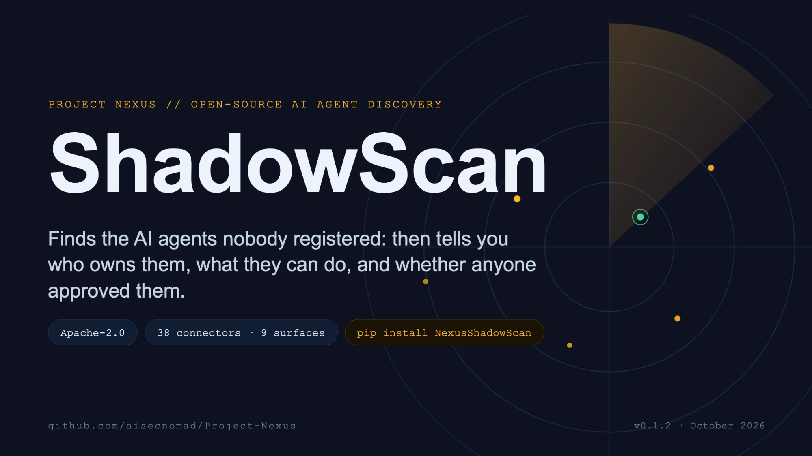
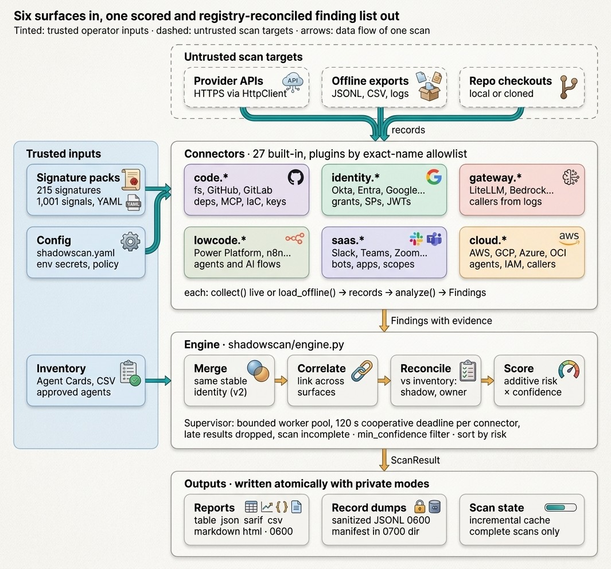
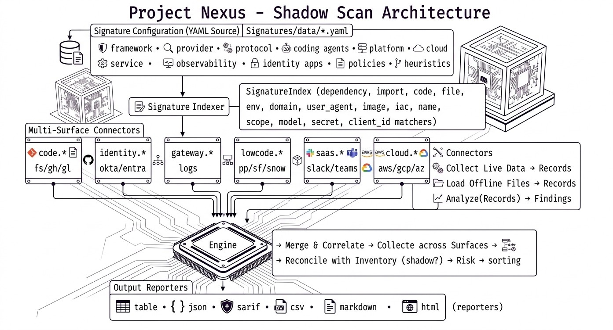

<p align="center">
  
</p>

<h1 align="center">Project Nexus · ShadowScan</h1>

<p align="center">
  <strong>Finds the AI agents nobody registered — then tells you who owns them, what they can do, and whether anyone approved them.</strong>
</p>

<p align="center">
  <a href="https://github.com/aisecnomad/Project-Nexus/actions/workflows/ci.yml"></a>
  <a href="https://github.com/aisecnomad/Project-Nexus/actions/workflows/codeql.yml"></a>
  <a href="https://scorecard.dev/viewer/?uri=github.com/aisecnomad/Project-Nexus"></a>
  <a href="https://github.com/aisecnomad/Project-Nexus/blob/main/LICENSE"></a>
  <a href="https://www.python.org/downloads/"></a>
  <a href="https://github.com/aisecnomad/Project-Nexus/blob/main/CONTRIBUTING.md#quality-gates"></a>
  <a href="https://pypi.org/project/NexusShadowScan/"></a>
  <a href="https://github.com/aisecnomad/Project-Nexus/tree/main/docs"></a>
</p>

---

**ShadowScan** is an open-source security tool that discovers evidence of AI agents and related integrations across your entire technology estate, then reconciles every finding against your approved agent registry.

It inspects nine surfaces: code repositories, identity providers, LLM gateway logs, low-code platforms, SaaS apps, cloud accounts, endpoints (developer workstations and host/runtime inventories), network logs, and running processes. It fingerprints frameworks and model providers, classifies autonomy, scores risk, and reconciles discoveries against your sanctioned inventory of [Agent Cards](https://github.com/aisecnomad/Project-Nexus/blob/main/agent-card.yaml).

```
$ shadowscan scan -c examples/shadowscan.offline.yaml --max-rows 5

╭──────────────────────────────── ShadowScan ────────────────────────────────╮
│ 133 findings  •  129 shadow (inventory: 4 registered agents)               │
│ critical 16  high 63  medium 54  •  cloud 30 identity 19 endpoint 18 …     │
╰────────────────────────────────────────────────────────────────────────────╯
 CRITICAL 100  SHADOW  code      mcp-server   MCP configuration: .mcp.json
 CRITICAL 100  SHADOW  saas      bot-app      GitHub App installed: claude
 CRITICAL  98  SHADOW  code      agent-config Claude Code configured in repository root
 CRITICAL  91  SHADOW  endpoint  agent-config OpenClaw configured on dev-laptop-07 (~dana)
 CRITICAL  90  SHADOW  code      secret       LLM provider credential in services/research-agent/app/config.py
```

<br>

## Table of Contents

- [The Why](#the-why)
- [How It Works](#how-it-works)
- [Architecture](#architecture)
- [Surfaces & Connectors](#surfaces--connectors)
- [Frameworks & Products Recognized](#frameworks--products-recognized)
- [Install](#install)
- [Quick Start](#quick-start)
- [Configuration](#configuration)
- [What a Finding Looks Like](#what-a-finding-looks-like)
- [Sanctioned Inventory](#sanctioned-inventory)
- [Extending](#extending)
- [Documentation](#documentation)
- [Development](#development)
- [Evidence and Assurance Limits](#evidence-and-assurance-limits)
- [Project Status](#project-status)
- [Community and Contributing](#community-and-contributing)
- [Safety Notes](#safety-notes)
- [License](#license)

<br>

## The Why

Agents are no longer only Python scripts.
They are Copilot Studio bots built by HR, `n8n` flows with an *AI Agent* node, OAuth grants to meeting note-takers,
Bedrock Agents provisioned by Terraform, MCP servers wired into every
developer's editor, service principals with `Mail.ReadWrite` acting on behalf of nobody, and JWTs carrying an `act` claim.
Each surface has its own discovery API and its own vocabulary.
ShadowScan normalizes these observations into one finding model with evidence,
so investigators or auditors can ask: *Who owns this AI Agent? What can it do, and is it
registered in the agent registry supplied for this scan?*

| Observation | What it establishes | Next check |
|---|---|---|
| Source dependency, import, or configuration | A repository contains a potential integration. | Inspect executable code and deployment; comments, examples, and unused dependencies can mislead. |
| Cloud or SaaS resource | The collector observed a configured resource within its granted scope. | Check resource state and authenticated runtime telemetry before claiming execution. |
| Gateway event | The supplied log contains a request or tool-use signal. | Verify the log's origin, caller binding, and observation window before attributing it to a deployed agent. |
| `shadow: true` | No single explicit binding in the **supplied** inventory matched the finding. | Confirm the inventory's scope and freshness; an unmatched finding alone does not prove unauthorized use. |

<br>

## How It Works

```
connectors ── live API (collect) or offline export (input) ──► records
records ── analyze() against YAML signature packs ──► findings with evidence
findings ── merge ─► correlate across surfaces ─► reconcile with inventory and trusted
            registries ─► classify autonomy ─► score risk ─► (opt-in) LLM triage
report ──── table · json · sarif · csv · markdown · html · cyclonedx · ocsf
JSON reports ── diff · merge (fleet) · dashboard · controls · inventory stubs
```

Detection knowledge lives in YAML signature packs and threat and control
references in YAML mapping catalogs, so adding a product is a data change, not
a code change. Collection and analysis fail closed: an API error, a timeout, a
limit or a malformed export marks the scan incomplete (exit 3) rather than
producing a smaller report that looks clean. Only the opt-in LLM triage is
advisory; its failures are warnings. See
[architecture](https://github.com/aisecnomad/Project-Nexus/blob/main/docs/architecture.md)
for the pipeline, the package layout and the connector contract.

<br>

## Architecture

<p align="center">
  
</p>

<p align="center"><em>Nine surfaces in, one scored and registry-reconciled finding list out. Tinted: trusted operator inputs. Dashed: untrusted scan targets. Arrows: data flow of one scan.</em></p>

<details>
<summary><strong>Detailed architecture diagram</strong></summary>
<br>
<p align="center">
  
</p>
<p align="center"><em>Signature configuration, multi-surface connectors, engine pipeline, and output reporters.</em></p>
</details>

<br>

## Surfaces & Connectors

ShadowScan ships **38 connectors** across the nine surfaces below.

| Surface | Connectors | What is discovered |
|---|---|---|
| **Code** | `code.filesystem`, `code.github`, `code.gitlab` | Agent frameworks & LLM SDKs (deps, imports, idioms), MCP client/server configs, coding-agent configs (Claude Code sub-agents, Copilot custom agents, Cursor/Codex/Gemini CLI...), A2A agent cards, M365 declarative agents, CrewAI/LangGraph manifests, exported n8n/Flowise/Langflow/Dify flows, IaC provisioning Bedrock/Vertex/Foundry/OCI agents, container images, CI secret names, hard-coded provider keys (redacted) |
| **Identity** | `identity.okta`, `identity.entra`, `identity.google-workspace`, `identity.auth0`, `identity.jwt` | OAuth apps & consent grants to AI SaaS, service apps/service principals / managed identities with LLM or data permissions, app registrations that look like agents, JWT classification (human/service/workload / delegated-agent) with privilege and hygiene analysis |
| **Gateway** | `gateway.logs`, `gateway.otel` | Callers reconstructed from gateway logs or offline OpenTelemetry GenAI spans; span prompt/completion content is not retained |
| **Low-code** | `lowcode.power-platform`, `lowcode.salesforce`, `lowcode.servicenow`, `lowcode.n8n`, `lowcode.make`, `lowcode.zapier`, `lowcode.workato` | Copilot Studio agents & topics, Power Automate/Apps using AI connectors, Agentforce planners/topics/actions, Einstein bots, prompt templates, Now Assist AI agents/tools/triggers, automation workflows with AI or agent steps |
| **SaaS** | `saas.slack`, `saas.microsoft-teams`, `saas.github-apps`, `saas.atlassian`, `saas.notion`, `saas.zoom`, `saas.generic` | Bots and apps with their scopes, pending install requests, Teams apps with bots / Copilot agents, GitHub Apps (AI reviewers, coding agents) and their permissions, Rovo/Marketplace apps, Notion integrations, Zoom approved and account-created Marketplace apps (approval does not prove installation), any CSV/JSON app inventory (CASB exports) |
| **Cloud** | `cloud.aws`, `cloud.gcp`, `cloud.azure`, `cloud.oci`, `cloud.kubernetes`, `cloud.openshift` | Managed cloud AI and IAM inventories, plus offline Kubernetes/OpenShift workload exports (images, exposure, GPU, privilege, and egress-policy indicators) |
| **Endpoint** | `endpoint.inventory`, `endpoint.host`, `endpoint.mcp`, `endpoint.ollama`, `endpoint.models`, `endpoint.ebpf` | AI clients and coding agents configured in home directories with their MCP servers and posture (Claude Desktop/Code, Cursor, VS Code, Windsurf, Gemini CLI, Codex, Goose, Cline, Roo, OpenClaw...), AI editor and browser extensions, local model stores (Ollama, LM Studio, Hugging Face, GPT4All, Jan), opt-in shell-history tool counts; osquery fleet exports; offline host/runtime, MCP tool-list, local model metadata, and eBPF event exports through the `endpoint.*` inventories, which do not probe endpoints live except opt-in A2A Agent Card fetches from listed URLs (`endpoint.mcp`) |
| **Network** | `network.logs` | AI services contacted per client address from Zeek DNS/TLS/connection logs, Route 53 Resolver query logs, VPC Flow Logs or generic DNS/SNI exports; strict host matching, DNS-attributed flows that refuse shared CDN addresses, agent-service and agent-loop indicators |
| **Runtime** | `runtime.processes` | Coding-agent CLIs, AI desktop apps, MCP servers, local model servers and agent dev servers seen running, from osquery, Defender or CrowdStrike process exports or `/proc`; command lines are never kept; linked to the endpoint findings for the same tool on the same device (`observed-running`) |

Connectors support **live** API collection, **offline** JSON/CSV/log exports,
or both; see the [connector guide](https://github.com/aisecnomad/Project-Nexus/blob/main/docs/connectors.md) for the supported modes and provider scope.
Offline analysis can run in CI, on an analyst's laptop, or against a SIEM export.
The offline inventories (`endpoint.host`, `endpoint.mcp`, `endpoint.ollama`, `endpoint.models`,
`endpoint.ebpf`, `gateway.otel`, `cloud.kubernetes`, `cloud.openshift`) analyze exports; they do
not probe MCP/Ollama endpoints, access a Kubernetes API, or parse model files. The one opt-in exception
is `endpoint.mcp`, which fetches the A2A Agent Cards of agents listed in `agent_card_urls`. When no `input` is set,
`endpoint.inventory` reads a fixed list of local user-scope locations (model stores are listed by file
name, never parsed) and `runtime.processes` reads `/proc` on Linux.

<br>

## Frameworks & Products Recognized

233 signatures / 1133 signals, YAML-defined with explicit opt-in overrides:

* **Orchestrators** – LangChain, LangGraph, Deep Agents, LlamaIndex, CrewAI, Google ADK, AWS Strands Agents, Microsoft Agent Framework, Semantic Kernel, Microsoft.Extensions.AI, AutoGen/AG2, Hugging Face smolagents and Transformers Agents, OpenAI Agents SDK, OpenAI Swarm, Agency Swarm, Claude Agent SDK, Pydantic AI, Vercel AI SDK, Mastra, Haystack, DSPy, Instructor, Embedchain, Agno, Letta, MetaGPT, CAMEL, Griptape, Composio, Langroid, AgentScope, Swarms, AutoGPT, BabyAGI, BeeAI, Atomic Agents, Julep, Marvin, Mirascope, Qwen-Agent, NVIDIA NeMo Agent Toolkit, Dapr Agents, PraisonAI, SWE-agent, GPT Engineer, Open Interpreter, Chainlit, Prompt flow, Guardrails AI / NeMo Guardrails / LLM Guard, LangChain4j, Spring AI, Koog, Rig, LangChainGo, Genkit, Eino, M365 Agents SDK, Bot Framework, Teams AI, Cloudflare Agents, Inngest AgentKit, VoltAgent, CopilotKit/AG-UI, Rasa, Botpress, Browser Use, Stagehand, OpenHands, Nova Act, Anthropic computer use
* **Protocols** – MCP (all client config locations, servers, registries, remote MCP hosts), A2A agent cards, ACP, tool/function-calling request shapes, ChatGPT plugin/GPT Action manifests
* **Coding agents** – Claude Code, GitHub Copilot coding agent, Devin, Cursor, Windsurf, Cline, Roo, OpenAI Codex, Gemini CLI/Jules, Amazon Q/Kiro, Goose, Aider, Continue, Cody/Amp, Junie, AGENTS.md, PR review bots (CodeRabbit, Sweep, Ellipsis, Greptile, Qodo...)
* **Platforms/gateways** – LiteLLM, Portkey, Kong AI Gateway, Helicone, MLflow AI Gateway, OpenAI AgentKit, Dify, Flowise, Langflow, n8n, Make, Zapier, Workato, Copilot Studio, Power Platform AI connectors, M365 declarative agents, Agentforce, Now Assist, IBM watsonx Orchestrate, Retool, Rivet, Browserbase, Open WebUI/LibreChat/AnythingLLM, Coze/Relevance/Lindy/Vellum...
* **Model providers** – OpenAI, Anthropic, Gemini API, Vertex AI, Bedrock, Azure OpenAI, Mistral, Cohere, Groq, Together, Fireworks, OpenRouter, Ollama, vLLM, SGLang, llama.cpp, LM Studio, LocalAI, Llama Stack, Meta Llama API, Hugging Face, xAI, DeepSeek, Alibaba DashScope/Qwen, Moonshot/Kimi, AI21, Perplexity, Voyage AI, Replicate, Cerebras, SambaNova, NVIDIA NIM, OCI Generative AI, watsonx, Databricks, Cloudflare Workers AI, Snowflake Cortex (deps, imports, endpoints, env vars, user agents, model IDs, **key formats**)
* **Observability/memory/sandboxes** – LangSmith, Langfuse, Phoenix, AgentOps, Traceloop, Weave, Braintrust..., Mem0, Zep, vector stores, E2B, Daytona, web search/scrape tool providers
* **AI SaaS as OAuth apps** – ChatGPT, Claude, Gemini, Copilot, Perplexity, Mistral Le Chat, DeepSeek, Qwen, Kimi, Grok, Poe, Character.ai, Glean, meeting note-takers (Otter, Fireflies, Read.ai, Fathom, tl;dv, Gong...), writing/coding/automation/research/media products, browser AI extensions
* **Permission policies** – privileged, data-access and LLM-access scope classes across Graph, Google, Okta, Slack, GitHub, GitLab, Salesforce, Atlassian, Zoom, Notion, HubSpot, AWS IAM, Azure RBAC, GCP IAM, OCI

`shadowscan signatures list` shows everything; `shadowscan signatures test <value>`
tells you what a package, host, user agent, model ID, scope, or file path maps to.

<br>

## Install

### Quick install (PyPI)

```bash
python -m pip install NexusShadowScan            # or: pipx install NexusShadowScan
python -m pip install "NexusShadowScan[cloud]"   # adds the AWS, GCP, Azure and OCI SDKs
shadowscan --help
```

The distribution is `NexusShadowScan`; the command and Python imports are
`shadowscan`. The unrelated `shadowscan` package on PyPI is not this project.
Python 3.11, 3.12 or 3.13 is required. Releases are uploaded only by the
maintainer-approved [publish job](https://github.com/aisecnomad/Project-Nexus/blob/main/.github/workflows/release.yml)
through PyPI trusted publishing. The uploaded wheel is the same file that job
attests on GitHub, so you can check a downloaded wheel against this repository:

```bash
python -m pip download --no-deps --dest wheels NexusShadowScan==0.1.2
gh attestation verify wheels/nexusshadowscan-0.1.2-py3-none-any.whl --repo aisecnomad/Project-Nexus
```

A plain `pip install` resolves dependencies from the live index. For a
deployment, prefer the hash-locked install.

### Deployment install (reviewed revision, hash-locked)

Select the full 40-character commit SHA after reviewing its changes and CI
results. Set `SHADOWSCAN_REVISION` to that SHA; do not use a moving branch or an
unpublished tag in a deployment job. From a clean checkout and virtual
environment, install the checked-in runtime and build locks, then build and
install the wheel:

```bash
SHADOWSCAN_REVISION="REPLACE_WITH_REVIEWED_40_CHARACTER_SHA"
git clone https://github.com/aisecnomad/Project-Nexus.git
cd Project-Nexus
git checkout --detach "$SHADOWSCAN_REVISION"
test "$(git rev-parse HEAD)" = "$SHADOWSCAN_REVISION"
python -m venv .venv
source .venv/bin/activate
python -m pip install --require-hashes --only-binary=:all: -r requirements.lock
python -m pip install --require-hashes --only-binary=:all: -r requirements-build.lock
python -m pip wheel . --no-deps --no-build-isolation --wheel-dir dist
python -m pip install --no-deps dist/nexusshadowscan-0.1.2-*.whl
```

The checked-in runtime lock includes the core scanner and cloud dependencies.
It is validated for Linux x86_64 with Python 3.11 to 3.13. Build and retain the
wheel from this reviewed commit; see
[locked installs and release evidence](https://github.com/aisecnomad/Project-Nexus/blob/main/docs/production.md#install-from-a-reviewed-revision)
for validation and artifact-retention requirements.

The source version string `0.1.2` is not, by itself, evidence of a published or
signed artifact; the package index and the release evidence are. Python 3.11,
3.12, or 3.13 is required and covered by CI; 3.14 is excluded until the CI matrix and
hash-locked dependency sets cover it. Core dependencies include `click`, `rich`,
`PyYAML`, `requests`, `urllib3`, `PyJWT[crypto]` and `regex`. Cloud SDKs are
optional extras; every cloud connector also accepts an offline record dump.

<details>
<summary><strong>Development install (non-reproducible)</strong></summary>

For development only, the VCS install resolves transitive dependencies at
install time. It is not hash-locked or reproducible and must not be used for
deployment or CI gating.

```bash
SHADOWSCAN_REVISION="REPLACE_WITH_REVIEWED_40_CHARACTER_SHA"
python -m pip install "git+https://github.com/aisecnomad/Project-Nexus.git@${SHADOWSCAN_REVISION}"
```

For cloud development, install the extra from the same reviewed revision:

```bash
SHADOWSCAN_REVISION="REPLACE_WITH_REVIEWED_40_CHARACTER_SHA"
python -m pip install "NexusShadowScan[cloud] @ git+https://github.com/aisecnomad/Project-Nexus.git@${SHADOWSCAN_REVISION}"
```

The [consumer GitHub Action example](https://github.com/aisecnomad/Project-Nexus/blob/main/examples/github-action-code-scan.yml) requires
the repository variable `SHADOWSCAN_REVISION` to hold that reviewed full SHA;
it fails until the variable is set.

</details>

<br>

## Quick Start

```bash
# 1. Scan a checkout (or your whole ~/src) — no credentials needed
shadowscan code . --inventory agent-card.yaml
shadowscan code . --diff-base origin/main     # pull request scope (Git 2.45+): committed changes only; never resolves findings in diff

# 2. Try every fixture-backed connector offline (demo; 36 of 38 connectors ship fixtures)
shadowscan scan -c examples/shadowscan.offline.yaml --format html -o report.html

# 3. Real estate: one config, live connectors, secrets from the environment
shadowscan scan -c shadowscan.yaml --format sarif -o shadowscan.sarif

# 4. Single connector, ad-hoc
shadowscan run identity.entra --set tenant_id=$AZURE_TENANT_ID
shadowscan run cloud.aws --set regions=us-east-1,eu-west-1 --dump-records ./exports
# Read exports/manifest.json and use the exported filename for this instance:
shadowscan run cloud.aws --input ./exports/0001-cloud_aws.jsonl   # reanalyze later, offline

# 5. Logs and tokens
shadowscan gateway litellm-spend.jsonl bedrock-invocations/ egress-proxy.log
shadowscan jwt --file ./token.jwt --jwks-url https://acme.okta.com/oauth2/default/v1/keys

# 6. Developer workstations (well-known client locations only, never the whole home)
shadowscan endpoint --list                                       # which AI client locations exist here
shadowscan endpoint --format json -o laptop-$(hostname).json     # MCP configs, skills, rules, hooks
shadowscan merge laptop-*.json --format json -o fleet.json       # one report for the fleet
shadowscan dashboard fleet.json -o dashboard.html --inventory-json inventory.json   # static fleet dashboard

# 7. Register what you found
shadowscan inventory stubs report.json -o inventory/pending/    # capability-card stubs for shadow agents
shadowscan diff last-week.json today.json                        # what is new / resolved/changed
shadowscan diff baseline.json today.json --fail-on-drift inventory,capability,autonomy,governance  # exit 2 on adverse drift
shadowscan scan -c shadowscan.yaml --format cyclonedx -o ai-bom.json   # CycloneDX 1.6 bill of materials
shadowscan controls today.json --format csv -o controls.csv      # findings per NIST AI RMF / ISO 42001 / EU AI Act / AIUC-1 control
```

Steps 1 and 2 need a repository checkout: `agent-card.yaml`, `examples/` and
the sample exports under `tests/fixtures/` are not shipped in the wheel. Steps
5 and 7 use your own logs, token, and an earlier JSON report
(`--format json -o report.json`); step 6 writes the per-machine reports that
`merge` and `dashboard` read. Sample gateway logs live under
`tests/fixtures/gateway/` in a checkout. Scanning the ShadowScan checkout
itself reports an incomplete scan (exit 3): some redaction rules and tests
intentionally exceed the sanitizer's limits, and some committed benchmark
corpora and results exceed the default `max_file_size`. The scanner fails
closed rather than skip them silently.

<br>

## Configuration

```yaml
# shadowscan.yaml
inventory: [./inventory]              # Agent Cards, agents.yaml or CSV
signatures: [./custom-signatures]     # optional: extra packs; overrides require opt-in
options:
  plugins: []                        # exact names of reviewed third-party connectors
  allow_signature_override: false
  allow_private_origin: false        # opt in only for trusted private HTTPS APIs
  allow_credential_mixing: false     # separate repository scans from live tenant access
  allow_instance_credentials: false # cloud metadata credentials require explicit opt-in
  connector_timeout_seconds: 120    # soft deadline; also enforce a host job timeout
  parallel: 4                        # worker threads; use 1-2 for CPU-bound offline scans
  min_confidence: 0.3
  dump_records: ./exports             # sanitized records for offline re-runs; excludes JWTs
connectors:
  - name: identity.entra
    tenant_id: ${AZURE_TENANT_ID}
    client_id: ${AZURE_CLIENT_ID}
    client_secret: ${AZURE_CLIENT_SECRET}
  - name: identity.google-workspace
    service_account_file: ./sa.json
    admin_email: admin@acme.com
  - name: gateway.logs
    label: litellm-prod                # names this entry in --only, progress and exports
    input: ./exports/litellm-spend.jsonl
  - name: lowcode.power-platform
    tenant_id: ${AZURE_TENANT_ID}
    client_id: ${AZURE_CLIENT_ID}
    client_secret: ${AZURE_CLIENT_SECRET}
  - name: saas.slack
    enabled: false                     # keep the entry, skip it on this run
    token: ${SLACK_TOKEN}
  - name: cloud.aws
    regions: [us-east-1, eu-west-1]
    cloudtrail_days: 7
```

### Credential boundaries

`shadowscan connectors` lists each connector's configuration keys and required
extras; `shadowscan connectors --json` also lists offline export formats. Entries
accept `enabled` (default `true`) and `label` (a distinct ID when a connector runs
more than once). See [connector keys and least-privilege scopes](https://github.com/aisecnomad/Project-Nexus/blob/main/docs/connectors.md).
Run repository scans separately from live tenant collection. Mixing these
credential boundaries requires the explicit `allow_credential_mixing` exception;
keep them separate for untrusted repositories. Cloud instance-metadata credentials
require `allow_instance_credentials: true`; use an explicit audit identity by default.

### Coverage and exit codes

Oversize files the scanner would inspect and symbolic links that leave the scan
root make coverage incomplete (exit 3) by default. `--strict-coverage`
(`strict_coverage: true`) records them as errors instead of warnings;
`oversize_skip_globs` remain declared warnings. An in-root link is complete when
its name is never read (for example, a lockfile or image), or when it is a source
file whose target is analyzed in the same project with the same test
classification. Directory links are incomplete because their alias paths are
not scanned. A file analyzed by name but unreadable as text (dense NUL bytes,
mostly invalid UTF-8, or UTF-16 or UTF-32 without a byte-order mark) is also a gap;
legacy-encoded text and a few stray NUL bytes are analyzed with a warning. Non-empty
`bin/`, `build/`, `dist/`, `vendor/` and similar directories skipped by default
are listed in a warning; `--no-default-excludes` scans them. Evidence found only
in test or fixture code cannot establish an agent unless `--include-tests` is set.
See [scan semantics](https://github.com/aisecnomad/Project-Nexus/blob/main/docs/scanning.md) for the full coverage policy.

| Exit | Meaning |
|---|---|
| **3** | Scan incomplete. `shadowscan diff` also returns 3 when reports are incomparable, for example live scans other than complete, attested `cloud.aws`, `cloud.azure`, `cloud.gcp` and `identity.entra` collections, or an expired or undatable baseline with `--max-baseline-age-days`. |
| **2** | Scan completed but reached `--fail-on`. `shadowscan diff` returns 2 for new findings or a higher risk level with `--fail-on-new`, and for adverse drift with `--fail-on-drift`. |
| **1** | No scan result: invalid option, value, path or configuration, or setup/output error. |
| **0** | Scan completed and passed. |

Gate CI on any non-zero exit. SARIF marks incomplete scans unsuccessful while
preserving findings from successfully assessed inputs. Enable `--fail-on` only
after a [frozen, independently adjudicated holdout](https://github.com/aisecnomad/Project-Nexus/blob/main/docs/evaluation.md#gate-a-frozen-holdout)
and [read-only tenant canary](https://github.com/aisecnomad/Project-Nexus/blob/main/docs/evaluation.md#read-only-tenant-canary-procedure)
establish an acceptable threshold for that environment. A complete static scan
does not prove agent execution or collection of every eligible resource. The CLI
normally exits promptly after a connector deadline even if a blocked worker
cannot be joined; filesystem publication already in progress can delay timeout
handling. `--job-deadline-seconds` (`options.job_deadline_seconds`) bounds the
whole CLI process, setup and output included, and exits 3 when it expires; it
does not reap subprocesses, so still enforce a host job timeout for hard
limits. Confidence thresholds must be finite numbers from 0 to 1; invalid CLI
or YAML values stop the scan before the risk gate runs.

### Incremental and runtime correlation

Use `--incremental` to reuse completed scans of unchanged local checkouts and
static cloud exports. Live APIs and gateway logs are refreshed on each run.
Configure `gateway.logs.correlation_bindings` to link a code resource to a
specific gateway caller and scope. Matching timestamped framework fingerprints
then appear in `metadata.runtime_activity`, including the observation window and
any production label claimed in the logs. Treat caller and environment fields
according to export provenance; ShadowScan does not authenticate an imported
log's source. See [scan state and runtime correlation](https://github.com/aisecnomad/Project-Nexus/blob/main/docs/scanning.md) for
configuration and limitations.

Git history enrichment is disabled by default. Set connector `use_git: true`
only for a reviewed local checkout when author/history metadata is needed;
metadata commands cannot fetch missing objects. Every explicit `--only` selector
must match an enabled connector name or label. Unsupported records and saved API
error responses cannot establish an empty, successful inventory.

### Upgrading baselines

After upgrading from reports without the v2 finding-identity schema, regenerate
your comparison baseline. Findings retain identity when inferred classification
changes; legacy baselines cannot establish resolution under the new schema. See
[deployment and migration](https://github.com/aisecnomad/Project-Nexus/blob/main/docs/production.md) for rollout checks.

<br>

## What a Finding Looks Like

```json
{
  "id": "ss-3f9c1e2a7b4d8c10",
  "surface": "cloud", "connector": "cloud.aws", "kind": "agent",
  "title": "Bedrock AgentCore runtime: strands_support_agent",
  "resource": "arn:aws:bedrock-agentcore:us-east-1:123456789012:runtime/rt1",
  "account": "123456789012", "region": "us-east-1", "owner": null,
  "frameworks": ["cloud.aws-bedrock-agents"], "model_providers": ["provider.openai"],
  "capabilities": ["tool-use"], "tags": ["plaintext-credential", "secret-in-env"],
  "confidence": 1.0, "likelihood": "strong",
  "shadow": true, "registry_match": null,
  "risk": {"score": 90, "level": "critical", "factors": [
      {"id": "shadow", "description": "not present in the sanctioned agent inventory", "weight": 25},
      {"id": "tag:plaintext-credential", "description": "plaintext credential in environment/configuration", "weight": 25},
      {"id": "no-owner", "description": "no identifiable owner", "weight": 10}, "..."]},
  "evidence": [
      {"signal": "aws:agentcore-runtime", "description": "AgentCore runtime 'strands_support_agent' (READY) role arn:aws:iam::...", "weight": 0.97},
      {"signal": "secret: provider.openai", "description": "Plaintext OpenAI API key in environment variable OPENAI_API_KEY: sk-p...KLMN", "weight": 0.6}],
  "metadata": {"status": "READY", "protocol": "HTTP", "network": "PUBLIC", "related": ["ss-..."],
      "threats": ["maestro-2025:L3", "mitre-atlas-2026.09:AML.T0055", "owasp-asi-2026:ASI03", "owasp-llm-2026:LLM02"],
      "controls": ["aiuc-1-2026q2:B", "aiuc-1-2026q2:E", "eu-ai-act-2024:Art.15", "..."]}
}
```

<details>
<summary><strong>Understanding finding fields</strong></summary>

* **confidence** combines evidence weights with noisy-OR after grouping correlated evidence, so each group counts once at its strongest weight. A code project groups its matches by technology; on every other surface, repeated matches of one signal form one group. A single-file code finding (a workflow export, IaC, agent configuration) still counts each distinct matched pattern. It is a heuristic evidence score, not a calibrated probability or proof that an agent executed.
* **potential_capabilities** in static finding metadata records framework features supported only by availability evidence, such as an import or dependency. These are excluded from capability risk factors until stronger source evidence supports them.
* **risk** is additive and explainable: kind, capabilities (code-exec, autonomous, SaaS actions...), permission classes, credential exposure, exposure/auditability tags, registration status, ownership — scaled by confidence. The listed factors always add up to `score`; confidence scaling and the 0–100 bounds appear as factors.
* **danger_score** is the same model without the governance factors (inventory registration and ownership): what the agent can do, independent of whether anyone approved it. Set `options.risk_basis: danger` to base `level` and `--fail-on` on it, and `options.risk_weights` to tune weights (see [Risk policy](#risk-policy)).
* **shadow** is `true` unless exactly one inventory entry matches an explicit resource pattern and its configured scope restrictions; names only suggest entries for review. An approved entry lends its owner to the finding.
* **autonomy** (`metadata.autonomy`) places agents, agent configurations, MCP servers, workflows, bots, callers, apps, processes and AI cloud resources on the L0 Chatbot to L5 Fully Autonomous scale as an interval: the `floor` the evidence proves and the `ceiling` that positive evidence has not ruled out (L5 without such evidence), with `oversight`, `initiation` and the rules behind them. A Capability Card with `schema_version: 2` declares a level; one below the floor adds the `autonomy-understated` tag. See [autonomy tiers](https://github.com/aisecnomad/Project-Nexus/blob/main/docs/concepts/autonomy.md).
* **related** links findings across surfaces (the Terraform that provisions an agent <-> the agent in the account <-> the role calling Bedrock <-> the CloudTrail caller).
* **threats** and **controls** are edition-qualified references to OWASP, MITRE ATLAS and MAESTRO entries and to NIST AI RMF, ISO/IEC 42001, EU AI Act and AIUC-1 controls, derived from the finding at export. They are evidence references and author mappings, not compliance determinations; see [mappings](https://github.com/aisecnomad/Project-Nexus/blob/main/docs/concepts/mappings.md).

</details>

### Output formats

`table` (terminal), `json`, `sarif` (GitHub code scanning; code
findings carry file: line locations; results are warnings or notes with the
heuristic risk level, never a CVSS `security-severity`, see
[severity](https://github.com/aisecnomad/Project-Nexus/blob/main/docs/severity.md)), `csv`, `markdown`, `html` (self-contained,
filterable, with evidence drill-down), `cyclonedx` (a CycloneDX 1.6 AI bill
of materials, see [AI-BOM](https://github.com/aisecnomad/Project-Nexus/blob/main/docs/operations/ai-bom.md)), and `ocsf`
(OCSF 1.1.0 Detection Finding events for SIEMs and security data lakes, see
[OCSF](https://github.com/aisecnomad/Project-Nexus/blob/main/docs/operations/ocsf.md)).
`shadowscan dashboard` turns reports into a static fleet dashboard (coverage
per source and connector first, autonomy against shadow status, registry
reconciliation, threat and control reference counts, drift and history) and
a versioned `shadowscan.inventory/v1` JSON export for BI and SIEM tools; see
[fleet dashboard](https://github.com/aisecnomad/Project-Nexus/blob/main/docs/operations/dashboard.md). Opt-in
[LLM triage](https://github.com/aisecnomad/Project-Nexus/blob/main/docs/operations/llm-triage.md) adds an advisory model verdict to
the highest-risk findings; it is off by default and never changes scores.
CSV inserts a literal `'` at the start of
a value, and after each `,`, `;`, tab, `|` or line break inside it, when the
following text begins with `=`, `+`, `-` or `@` (also after whitespace or
quotes), a tab or a carriage return; values beginning with a line feed are also
marked. Other tabs and line breaks remain unchanged, and spreadsheet cells are
read as text regardless of delimiter. Strip markers for programmatic use or use
`json`; see [output and inventory migration](https://github.com/aisecnomad/Project-Nexus/blob/main/docs/production.md#output-and-inventory-migration).
`markdown` output defangs links (`hxxps://`, `www[.]`) and writes `@` as `[@]`
in untrusted text, so a report pasted into an issue or pull request creates no
links, @-mentions or e-mail links; code spans keep identifiers verbatim.

### Control evidence report

`shadowscan controls report.json` turns one or more JSON reports into a control
evidence report (Markdown, CSV for GRC tools, or JSON): for each NIST AI RMF,
ISO/IEC 42001, EU AI Act and AIUC-1 control, the findings that reference it by
risk level, the highest-risk examples, and whether the evidence is complete. A
control no finding references reads "not observed" only when every report is
complete and no finding could reference it through a missing inventory or an
undeclared risk class, and "unknown" otherwise; an incomplete input exits 3.
Evidence references, not compliance determinations; see
[control evidence report](https://github.com/aisecnomad/Project-Nexus/blob/main/docs/operations/controls.md).

### Risk policy

```yaml
options:
  risk_basis: danger          # combined (default) | danger: level from capabilities, not registration
  risk_weights:               # integers -100..100; unknown groups, kinds, capabilities, provider ids, governance or autonomy keys are rejected (tags may be custom)
    capabilities: {code-exec: 25}
    tags: {meeting-bot: 20}
    providers: {provider.deepseek: 20}
    kinds: {agent: 20}
    governance: {shadow: 15, no-owner: 5, registered: -10}  # and mcp-not-in-approved-registry (options.mcp_registries)
    autonomy: {L4: 10, L5: 20}  # observed autonomy floor L0..L5; every level defaults to 0
```

<br>

## Sanctioned Inventory

Drop your Agent Cards in a directory. The card's `metadata.agent_id`
identifies the registration; explicit `discovery.resources` bind it to concrete resources:

```yaml
metadata:
  agent_id: "ops-provisioning-04"
  owner_team: "Platform-Engineering"
discovery:
  resources:
    - "arn:aws:bedrock:*:123456789012:agent/AGENT1"
    - "github:acme/infra-agents/*"
  names: ["ops provisioning agent"]
```

Simple `agents.yaml` lists and CSV work too. A card with `schema_version: 2`
declares `autonomy_profile.level` (0 to 5); an older card's level is ignored
with a warning. Such a card may also declare governance facts the scanner
cannot observe (`governance:`: EU AI Act risk class, intended purpose,
oversight measures, AIUC-1 certificate, ISO/IEC 42001 scope); reports label
them declared. `shadowscan inventory stubs`
turns shadow findings into card skeletons for review. See
[docs/inventory.md](https://github.com/aisecnomad/Project-Nexus/blob/main/docs/inventory.md).

<br>

## Extending

* **Signatures** are YAML; add a pack directory with `--signatures` / `signatures:`
  to add products. Replacing built-in signatures requires explicit opt-in. Schema and authoring guide in
  [docs/signatures.md](https://github.com/aisecnomad/Project-Nexus/blob/main/docs/signatures.md).
* **Connectors** implement `collect()` (live) and `analyze()` (records -> findings)
  and register through the `shadowscan.connectors` entry-point group. Execution
  requires an exact-name `options.plugins` allowlist entry (or `--allow-plugin`),
  which can also pin the import target and the distribution version.
  `plugin_execution: process` runs each plugin in a worker the scanner can kill
  at its deadline; that is lifecycle isolation, not a sandbox, because a plugin
  keeps the scanner's privileges. See
  [docs/architecture.md](https://github.com/aisecnomad/Project-Nexus/blob/main/docs/architecture.md#writing-a-connector)
  and [third-party plugin execution](https://github.com/aisecnomad/Project-Nexus/blob/main/docs/connectors.md#third-party-plugin-execution).

<br>

## Documentation

The [`docs/`](https://github.com/aisecnomad/Project-Nexus/tree/main/docs)
directory of the revision you run is the source of truth.

| Topic | Pages |
|---|---|
| Getting started | [Installation](https://github.com/aisecnomad/Project-Nexus/blob/main/docs/getting-started/install.md), [quick start](https://github.com/aisecnomad/Project-Nexus/blob/main/docs/getting-started/quickstart.md), [configuration](https://github.com/aisecnomad/Project-Nexus/blob/main/docs/getting-started/configuration.md) |
| How it works | [Architecture](https://github.com/aisecnomad/Project-Nexus/blob/main/docs/architecture.md), [scan semantics](https://github.com/aisecnomad/Project-Nexus/blob/main/docs/scanning.md), [signatures](https://github.com/aisecnomad/Project-Nexus/blob/main/docs/signatures.md), [design decisions (ADRs)](https://github.com/aisecnomad/Project-Nexus/blob/main/docs/adrs/index.md) |
| Connectors | [Connector guide](https://github.com/aisecnomad/Project-Nexus/blob/main/docs/connectors.md), [configuration key reference](https://github.com/aisecnomad/Project-Nexus/blob/main/docs/connectors/reference.md) |
| Assessment | [Inventory](https://github.com/aisecnomad/Project-Nexus/blob/main/docs/inventory.md), [risk scoring](https://github.com/aisecnomad/Project-Nexus/blob/main/docs/concepts/risk.md), [autonomy tiers](https://github.com/aisecnomad/Project-Nexus/blob/main/docs/concepts/autonomy.md), [threat and control mappings](https://github.com/aisecnomad/Project-Nexus/blob/main/docs/concepts/mappings.md), [severity](https://github.com/aisecnomad/Project-Nexus/blob/main/docs/severity.md) |
| Operations | [CI integration](https://github.com/aisecnomad/Project-Nexus/blob/main/docs/operations/ci.md), [scheduled drift](https://github.com/aisecnomad/Project-Nexus/blob/main/docs/operations/drift.md), [fleet dashboard](https://github.com/aisecnomad/Project-Nexus/blob/main/docs/operations/dashboard.md), [control evidence report](https://github.com/aisecnomad/Project-Nexus/blob/main/docs/operations/controls.md), [AI-BOM](https://github.com/aisecnomad/Project-Nexus/blob/main/docs/operations/ai-bom.md), [OCSF](https://github.com/aisecnomad/Project-Nexus/blob/main/docs/operations/ocsf.md), [LLM triage](https://github.com/aisecnomad/Project-Nexus/blob/main/docs/operations/llm-triage.md) |
| Deployment and assurance | [Production deployment](https://github.com/aisecnomad/Project-Nexus/blob/main/docs/production.md), [evaluation](https://github.com/aisecnomad/Project-Nexus/blob/main/docs/evaluation.md), [tenant canaries](https://github.com/aisecnomad/Project-Nexus/blob/main/docs/canaries.md), [external reviewer packet](https://github.com/aisecnomad/Project-Nexus/blob/main/docs/operations/reviewer-packet.md) |

<br>

## Development

```bash
python -m venv .venv && source .venv/bin/activate
make install          # hash-locked runtime, cloud, dev and docs toolchain
make check            # lint, format, types, signatures, mappings, secrets, audit, coverage, connector floor, evaluation
shadowscan scan -c examples/shadowscan.offline.yaml
```

`make install` installs the hash-locked set CI uses, cloud SDKs included; a
core-only environment skips the tests that need them and does not validate
every connector. `make check` runs local copies of the CI quality gates (CI
also validates packaging and containers); `make help` lists the individual
targets. See
[CONTRIBUTING.md](https://github.com/aisecnomad/Project-Nexus/blob/main/CONTRIBUTING.md#getting-started)
to get started and its
[repository map](https://github.com/aisecnomad/Project-Nexus/blob/main/CONTRIBUTING.md#find-your-way-around)
for where the code, tests, docs, tooling and benchmarks live.

<br>

## Evidence and Assurance Limits

- **Evaluation corpora:** These are author-written regression cases, including
  multi-file cases with documented misses; they do not estimate field precision
  or recall. Confidence is a heuristic evidence score, not a measured probability,
  and detection quality depends on repositories, providers, tenant permissions,
  and log provenance. See [evaluation](https://github.com/aisecnomad/Project-Nexus/blob/main/docs/evaluation.md) and
  [rollout acceptance](https://github.com/aisecnomad/Project-Nexus/blob/main/docs/production.md#rollout-acceptance) before using a risk
  threshold as a production gate.
- **Benchmarks against other tools:** The
  [benchmarks](https://github.com/aisecnomad/Project-Nexus/blob/main/benchmarks/README.md),
  including the nine-surface ShadowBench, compare ShadowScan with other
  discovery tools on inputs and labels the same maintainer wrote. They show
  behaviour on those inputs, not field accuracy, and none is independent.
- **Assurance results:** The baseline and later results use a frozen corpus of
  42 public files (30 negatives), labeled by two AI reviewers before evaluation.
  The labelers share model capabilities, so these are not independent human
  ground truth; the corpus has since informed implementation, and only the
  baseline is out of sample.
- **Canaries:** [Read-only AWS and Slack canaries](https://github.com/aisecnomad/Project-Nexus/blob/main/docs/canaries.md) validate
  named tenant controls when approved credentials are supplied; offline replay
  does not establish live tenant acceptance.
- **Acceptance verifier:** The offline
  [verifier](https://github.com/aisecnomad/Project-Nexus/blob/main/tools/acceptance/README.md) requires current source and signature
  identities, declared human-reviewed holdout evidence, and live tenant receipts
  for supported live deployment scopes. It validates supplied evidence but
  cannot authenticate reviewer independence or manufacture tenant acceptance.
- **Release-evidence workflow:** The
  [workflow](https://github.com/aisecnomad/Project-Nexus/blob/main/.github/workflows/release.yml) builds a candidate wheel and retains
  hashes, a runtime dependency SBOM, and provenance after the selected commit
  passes CI and CodeQL. This does not establish deployment acceptance. It
  uploads to PyPI only when the maintainer dispatches it with `publish` set and
  approves the protected environment; it never creates a GitHub release.

<br>

## Project Status

* **Release state.** Version `0.1.2` is published to PyPI as `NexusShadowScan`
  and tagged `v0.1.2`, as an alpha pre-release. Verify the artifact identity on
  [PyPI](https://pypi.org/project/NexusShadowScan/0.1.2/) and the
  [GitHub release](https://github.com/aisecnomad/Project-Nexus/releases/tag/v0.1.2)
  before installing from the production index; publication does not establish
  independent review or deployment acceptance. Commits on `main` after the tag
  are unreleased. The package classifier is `Development Status :: 3 - Alpha`.
* **Single maintainer, AI-assisted development.** Apart from Dependabot updates, every commit was written
  by a single maintainer or generated with an AI coding assistant (Claude, Codex, Grok, GitHub Copilot, Google Antigravity, Perplexity, Meta AI, etc.). The logs under
  [archive/reviews/](https://github.com/aisecnomad/Project-Nexus/tree/main/archive/reviews) are AI-assisted, not third-party reviews.
* **Recommendation.** Review the revision yourself or have it reviewed, then
  pin that full commit SHA as shown in
  [Deployment install](#deployment-install-reviewed-revision-hash-locked).
  Review state cannot be established
  from a checkout; verify it with the commands in
  [merge gate and review status](https://github.com/aisecnomad/Project-Nexus/blob/main/docs/production.md#merge-gate-and-review-status).

<br>

## Community and Contributing

Contributions are welcome from developers, security practitioners, technical
writers and people testing the scanner against their own authorized data.
A small documentation fix or a reproducible false-positive report is useful.

| I want to... | Start here |
|---|---|
| Learn, ask a question or troubleshoot a scan | [Support guide](https://github.com/aisecnomad/Project-Nexus/blob/main/SUPPORT.md) |
| Report a bug, request a feature, or request a connector | [Issue forms](https://github.com/aisecnomad/Project-Nexus/issues/new/choose) |
| Report a false positive, a missed framework, or a wrong score | [Detection quality report](https://github.com/aisecnomad/Project-Nexus/issues/new?template=detection_report.yml) |
| Make a first contribution | [Contributor guide](https://github.com/aisecnomad/Project-Nexus/blob/main/CONTRIBUTING.md) and the [`good first issue`](https://github.com/aisecnomad/Project-Nexus/issues?q=is%3Aissue+is%3Aopen+label%3A%22good+first+issue%22) label |
| Understand decisions, review and release requirements | [Governance](https://github.com/aisecnomad/Project-Nexus/blob/main/GOVERNANCE.md), [Maintainers](https://github.com/aisecnomad/Project-Nexus/blob/main/MAINTAINERS.md), [Roadmap](https://github.com/aisecnomad/Project-Nexus/blob/main/ROADMAP.md) |
| Report a vulnerability privately | [Security policy](https://github.com/aisecnomad/Project-Nexus/blob/main/SECURITY.md#reporting) |
| Understand participation standards or report harmful conduct | [Code of conduct](https://github.com/aisecnomad/Project-Nexus/blob/main/CODE_OF_CONDUCT.md) |
| See what changed, or cite the project | [Release notes](https://github.com/aisecnomad/Project-Nexus/blob/main/RELEASE_NOTES.md), [Changelog](https://github.com/aisecnomad/Project-Nexus/blob/main/CHANGELOG.md), [CITATION.cff](https://github.com/aisecnomad/Project-Nexus/blob/main/CITATION.cff) |

Use synthetic, minimal examples in public reports. Scan results can contain
credentials, personal data, and sensitive inventory even after redaction.

<br>

## Safety Notes

* Known credential formats, sensitive configuration fields, and credential-bearing URLs are **redacted** before findings or sanitized record exports are persisted. Redaction cannot identify every arbitrary secret; reports still contain security-sensitive inventory data.
* Secret stores (Secrets Manager, Key Vault, Secret Manager, OCI Vault) are read for **names only**.
* JWTs are never persisted; findings reference a truncated hash.
* Built-in collectors inspect provider resources using read operations. Scope the audit identity to the documented read permissions and review any enabled third-party plugin separately.

Deployment behavior, migration options, and limits are documented in
[SECURITY.md](https://github.com/aisecnomad/Project-Nexus/blob/main/SECURITY.md) and [docs/production.md](https://github.com/aisecnomad/Project-Nexus/blob/main/docs/production.md).

<br>

## License

Apache-2.0. See [LICENSE](https://github.com/aisecnomad/Project-Nexus/blob/main/LICENSE) and [NOTICE](https://github.com/aisecnomad/Project-Nexus/blob/main/NOTICE).
