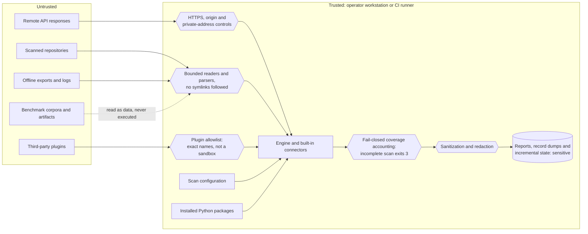

# Security

ShadowScan handles audit credentials and security findings. Protect configuration,
environment variables, record dumps, incremental state and reports as sensitive
data. Redaction reduces accidental disclosure; it does not make reports public.

**Reporting a vulnerability:** open a
[private GitHub security advisory](https://github.com/aisecnomad/Nexus-ShadowScan/security/advisories/new);
[Reporting](#reporting) says what to include and
[Supported versions](#supported-versions) which versions receive fixes. Never
put credentials, tenant exports or exploit details in a public issue.

## Supported versions

Version `0.1.2` is an alpha version. Fixes land on `main`; there is no
released-version backport commitment. Report the installed release version
and artifact identity, or the full commit SHA for a source installation.
Publication does not establish production acceptance for your environment.

## Reporting

Use a [private GitHub security advisory](https://github.com/aisecnomad/Nexus-ShadowScan/security/advisories/new).
Do not include credentials, private exports or exploit details in public issues.

### What to report privately

Report credential or private-data disclosure, redaction failures, unexpected
access outside the scan root or configured network origin, allowlist bypasses,
and malformed inputs that make incomplete coverage look complete. Reports about
CI or release-evidence integrity also belong in the private channel.

Ordinary false positives, missed integrations and incorrect attribution can use
the [detection report form](https://github.com/aisecnomad/Nexus-ShadowScan/issues/new?template=detection_report.yml)
when the reproduction is safe to publish. A trusted component being compromised
is outside the scanner's stated trust boundary; explain any demonstrated bypass
rather than assuming the scanner protects a compromised host.

### What to include

- The scanner release version and artifact identity, or full commit SHA for
  a source installation, plus the connector and collection mode. A candidate
  version alone does not identify a source revision.
- A minimal synthetic reproduction or public repository and commit, with
  expected and observed behavior.
- The security impact, affected artifacts and who could access them.
- Any relevant sanitized diagnostics; do not attach real credentials, JWTs or
  live tenant exports.

### Response and disclosure

This volunteer project has one maintainer and cannot guarantee response times.
Use the advisory to coordinate reproduction, a fix and disclosure timing. Fixes
land on `main`; there is no released-version backport commitment. A confirmed
fix should include a regression test and any necessary rollout or migration
notes. Reporter credit and publication timing should be agreed in the advisory.
Only test repositories, accounts and tenants you are authorized to assess.

## Threat model at a glance

ShadowScan reads security-sensitive estates and writes reports about them. The
diagram shows what it trusts, what it does not, and where each boundary is
enforced. The
[threat model](https://github.com/aisecnomad/Nexus-ShadowScan/blob/main/docs/security/threat-model.md)
maps each threat to its control, and
[controls and limits](https://github.com/aisecnomad/Nexus-ShadowScan/blob/main/docs/security/controls.md)
gives every control with what it does not cover.

### Trust boundary

The operator workstation or CI runner, the scan configuration and installed
Python packages are trusted. Remote API responses, scanned repositories,
offline exports, third-party plugins, and the benchmark corpora and artifacts
under `benchmarks/` (which hold prompt-injection text and MCP launch commands on
purpose and are never executed) are untrusted.

- **Fail closed.** Limits, malformed exports, denied APIs and timed-out
  connectors mark the scan incomplete (exit 3); an incomplete scan is never
  presented as an empty one.
- **Egress.** Shared `HttpClient` requests require HTTPS without embedded
  credentials, redirects and pagination stay on the configured origin, and
  private, loopback, link-local, metadata and other non-global addresses are
  rejected unless `allow_private_origin` grants them; `--deny-private-origin`
  refuses that grant.
- **Untrusted files.** Directory walks do not follow signature or inventory
  symlinks, offline exports use bounded reads without following symlinks, and
  parsers are bounded. The scanner does not act on scanned content: it never
  unpickles a model artifact or launches a discovered MCP server.
- **Plugins.** Third-party connector execution requires an exact-name allowlist
  in `options.plugins` or repeatable `--allow-plugin`, and an approved plugin
  runs with scanner privileges. Process mode is lifecycle isolation, not a
  sandbox: the worker starts without the credential-shaped variables exported
  for the built-in connectors unless `options.plugin_env` names them, but it
  runs as the scanner's user and can still read its parent's environment from
  `/proc/<ppid>/environ` on Linux, and every file that user can read. Pass
  credentials through files or a secrets manager rather than exported
  variables, and to keep a credential from an untrusted plugin, run that plugin
  under a separate user or in a separate container, in a scan job that does not
  hold the credential.
- **Credentials.** Use dedicated read-only audit credentials and narrowly
  scoped inventory approvals.

### What is redacted

Known token formats, JWTs, private key blocks, credential-bearing URLs and
values that their context names as credentials are withheld before findings or
record exports are persisted; secret stores are read for names only.
The full rules are in
[redaction](https://github.com/aisecnomad/Nexus-ShadowScan/blob/main/docs/security/redaction.md#what-is-redacted).

### What can remain

Redaction cannot withhold a credential that nothing names or shapes as one, and
a file over `max_file_size` is not read for credentials at all, so treat every
report as confidential. The forms that can remain are listed under
[what can remain](https://github.com/aisecnomad/Nexus-ShadowScan/blob/main/docs/security/redaction.md#what-can-remain).

## Further reading

- [Threat model](https://github.com/aisecnomad/Nexus-ShadowScan/blob/main/docs/security/threat-model.md):
  assets, trust boundaries, threats and controls in STRIDE terms, and residual risks.
- [Controls and limits](https://github.com/aisecnomad/Nexus-ShadowScan/blob/main/docs/security/controls.md):
  every implemented control, including the HTTP read deadline, Git, plugin and
  output-file safeguards.
- [Redaction](https://github.com/aisecnomad/Nexus-ShadowScan/blob/main/docs/security/redaction.md):
  what is withheld and what can remain.
- [Hardening log](https://github.com/aisecnomad/Nexus-ShadowScan/blob/main/docs/security/hardening-log.md):
  the maintainer's AI-assisted self-review hardening record, not an independent audit.
- [Deployment and migration](https://github.com/aisecnomad/Nexus-ShadowScan/blob/main/docs/production.md),
  [scan semantics](https://github.com/aisecnomad/Nexus-ShadowScan/blob/main/docs/scanning.md)
  and [connector permissions](https://github.com/aisecnomad/Nexus-ShadowScan/blob/main/docs/connectors.md).
