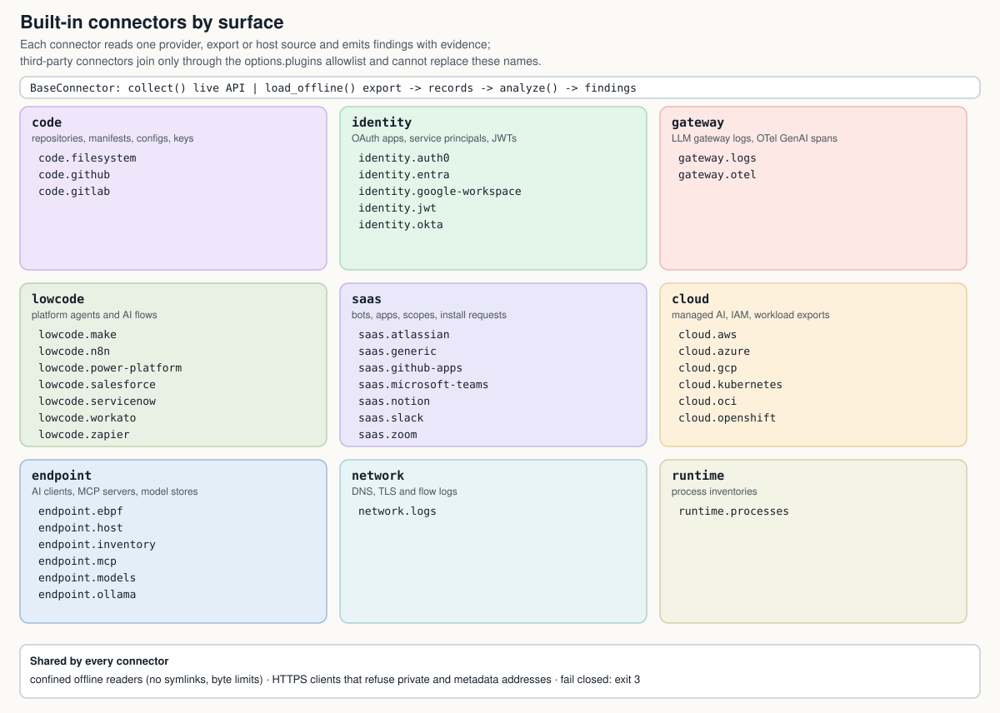

# Architecture

ShadowScan is a read-only command-line scanner. **Connectors** turn
provider APIs, offline exports, files and logs into **findings**. The
**engine** merges, correlates, reconciles and scores those findings, and
**reporters** publish the result. A second group of commands works on JSON
reports after a scan: comparison, fleet merge, the fleet dashboard and the
control evidence report.

Product knowledge lives in YAML signature packs and threat and control
knowledge in YAML mapping catalogs. The engine never names a product or a
connector; behaviour that differs by connector is a capability the connector
class declares (see [engine hooks](#engine-hooks)). Three policy tables outside
the engine do name built-in connectors: credential isolation (`config.py`),
incremental-cache eligibility (`incremental.py`) and the CycloneDX component
classes (`reporters/cyclonedx.py`).

```
 signatures/data/<category>/*.yaml: frameworks · providers · protocols · coding agents · platforms
 cloud services · identity apps · permission policies · observability · heuristics
                                      │
                                      │ SignatureIndex: dependency, import, code,
                                      │ file, env, domain, user_agent, image, iac,
                                      │ name, scope, model, secret, client_id
                                      ▼
┌──────────────────────────────── connectors ────────────────────────────────┐
│ code      filesystem · github · gitlab                                     │
│ identity  okta · entra · google-workspace · auth0 · jwt                    │
│ gateway   logs · otel                                                      │
│ lowcode   power-platform · salesforce · servicenow · n8n · make · zapier · │
│           workato                                                          │
│ saas      slack · microsoft-teams · github-apps · atlassian · notion ·     │
│           zoom · generic                                                   │
│ cloud     aws · gcp · azure · oci · kubernetes · openshift                 │
│ endpoint  inventory · host · mcp · ollama · models · ebpf                  │
│ network   logs                                                             │
│ runtime   processes                    + plugins named in options.plugins  │
│                                                                            │
│ collect()       live API  ─┐                                               │
│                            ├─► records ─► analyze() ─► findings            │
│ load_offline()  input     ─┘      └─► sanitized --dump-records export      │
└─────────────────────────────────────┬──────────────────────────────────────┘
                                      ▼
┌─────────────────────────────── Engine.run() ───────────────────────────────┐
│ supervised jobs: thread pool · deadlines · plugin workers · incremental    │
│ merge → correlate → MCP registry provenance → vendor registry              │
│ reconciliation → inventory match (shadow?) → autonomy · declared           │
│ governance → risk → min_confidence → sort → LLM triage (opt-in, advisory)  │
└─────────────────────────────────────┬──────────────────────────────────────┘
                                      ▼
 ScanResult ─► reporters ◄─ mappings/data/{frameworks,rules}/*.yaml: threat and control references
               table · json · sarif · csv · markdown · html · cyclonedx · ocsf
                                      │ json
                                      ▼
 JSON reports ─► diff · merge · dashboard (+ inventory.json on request) · controls · inventory stubs
```

## Scan pipeline

A scan runs these stages in order. The CLI (`shadowscan/cli/`) reads the
configuration in step 1 and renders the reports in step 7; `Engine.run()` in
`shadowscan/engine.py` runs the rest. Setup refuses an invalid or unsafe
configuration before anything is collected: the command exits 1 with no
report. Every later stage except the advisory LLM triage fails closed: a gap it
cannot fill is recorded in the scan statistics and makes the scan incomplete
(exit 3), never a smaller report that looks clean.

1. **Setup.** The CLI reads the YAML configuration with `ScanConfig`
   (`${VAR}` expansion, unknown and duplicate keys rejected) and applies
   command-line overrides. The engine loads the signature index (built-in packs
   plus `signatures:` packs), the inventory and the risk policy. Without
   `allow_credential_mixing` it rejects a scan that runs a code connector beside
   another live credentialed connector (cloud, identity other than
   `identity.jwt`, SaaS, low-code, a live remote repository or a plugin). These
   refusals exit 1. An `--only` selector that matches no enabled connector name
   or label is recorded instead: no connector runs and the scan is incomplete
   (exit 3).
2. **Collection.** Each connector entry runs as one job in a thread pool of
   `options.parallel` workers. A supervisor enforces each job's
   `connector_timeout_seconds` deadline. A live job calls `collect()`; an entry
   with `input` calls `load_offline()`. With `plugin_execution: process`, the
   default, an allowlisted plugin runs in a spawned worker that can be killed at
   its deadline (`plugin_process.py`). `--incremental` reuses a cached result for an
   unchanged `code.filesystem` checkout or an unchanged `input` export of a code
   or cloud connector (`incremental.py`); a diff-scoped or `include` scan always
   runs in full. `--dump-records` publishes sanitized records for offline
   replay. A live connector that declares `attests_live_scope` records the
   principal and listings its provider reported.
3. **Analysis.** Inside each collection job, under the same deadline,
   `analyze()` turns the records into findings as they stream in. Product
   knowledge comes from the signature index: each match becomes an `Evidence`
   with a weight (at most 12 per signature and signal type) and can add
   frameworks, model providers, capabilities, tags and policy classes.
   `finalize()` computes confidence and promotes `framework-usage` to `agent`
   when an agent indicator matched. After every job has finished, the engine
   builds the report's `collection_scope` from the selected inputs and the
   attested scope records (`comparison.py`).
4. **Post-processing**, in this order:
   1. **Merge** findings with the same stable identity (`merge.py`; see
      [finding identity](#finding-identity-and-merging)). A merged finding too
      large to sanitize within the output budget is dropped and reported as an
      `engine.postprocess` error.
   2. **Correlate** (`correlation.py`). Findings from different connectors or
      surfaces that share an exact identifier are linked in `metadata.related`,
      with `metadata.related_details` records of the identifier type, the
      matching fields and the scope. Pairwise lists remain bounded to 24 peers.
      Exact identifier groups larger than 25 observations retain compact
      `metadata.related_groups` memberships: findings with the same `group_id`
      share the recorded identifier type and identical verified scope. A capped
      exact pair from a smaller group also retains a two-member membership.
      `metadata.related_truncation` discloses omitted pairwise expansion;
      consumers must read group membership as well as `related` to reconstruct
      the available relationships. Large groups with compatible but different
      partial scopes are not merged: compatibility is not transitive. Group
      tokens are salted with the partition's verified scope, so per-tenant
      report slices cannot be joined on an identifier-equality assertion the
      link policy refuses; a member outside an exact-scope partition carries
      the omission disclosure without a token or count. Group
      tokens contain no raw identifier and establish no ownership, runtime
      activity or approval. A fully qualified reference (an ARN, a
      GCP resource name, an Azure resource id, an OCI OCID) carries its own
      account or project. A GCP service account address, bare or as
      `projects/<project>/serviceAccounts/<address>`, names one service
      account wherever it is used, so it links across projects. Code
      findings report repository paths, so there a `projects/` path is a GCP
      resource name only with a valid project id or number, a GCP collection
      after it, no `:<line>` suffix and no source-file extension on its last
      segment. Google-managed service accounts that many projects share
      (`@system.gserviceaccount.com`) link nothing. Identifiers are compared byte for
      byte, except Azure resource ids, which Azure Resource Manager treats
      case-insensitively and which are compared in ASCII lowercase. Shared
      AWS catalog ARNs (AWS-managed policies, Bedrock foundation models)
      identify no workload and are not compared.
      A local identifier links exactly only within a
      declared shared scope: the Entra tenant for an Entra application id
      (reported as `app_id`, `client_id`, a Teams `bot_id` or an Azure Bot
      `msa_app_id`), or a shared tenant, workspace, cloud account,
      subscription or project. Vendor names and gateway labels are not scope,
      and neither is an `account` its connector marks as not attributed to
      the records (`metadata.account_attributed: false`, an Entra export of
      another tenant).
      Normalised names, and equal local identifiers whose shared scope cannot
      be verified, produce only `metadata.related_candidates`, with candidate
      assurance and a limitation; they never enter the exact-link list. A
      conflicting declared tenant, account, subscription, project or
      workspace prevents both kinds of link. A declared scope value that
      cannot be compared (redacted, padded, or with wildcard characters, as a
      display name such as `Acme [EU]` has) gives its finding no identifier
      link, exact or candidate; its name similarity is still a candidate.
      These links describe the supplied observations, not independently
      verified ownership. Gateway activity is attached to the code it is bound
      to by `correlation_bindings` (`metadata.runtime_activity`). Endpoint
      findings are linked to a running process of the same tool on the same
      device (`metadata.lifecycle`, `observed-running`). Correlation changes
      neither confidence nor risk, unless an operator gives the
      `observed-running` tag a weight in `risk_weights`.
   3. **Match MCP servers** against the pinned MCP Registry snapshots in
      `options.mcp_registries` (`mcp_registry.py`).
   4. **Reconcile vendor registry records** with observed findings
      (`metadata.registry_reconciliation`, `registries.py`).
   5. **Reconcile with the inventory**, including the approved records of
      trusted registries: `shadow`, `registry_match` and an inherited owner
      (`registry.py`).
   6. **Classify autonomy** (`metadata.autonomy`, compared with a matched
      card's declared level; `autonomy.py`) and record the matched card's
      declared governance facts (`metadata.declared_governance`;
      `governance.py`).
   7. **Score** risk (`risk.py`).
5. **Filter and order.** Findings below `min_confidence` are dropped, together
   with the related, runtime, lifecycle and reconciliation links that name
   them. Vendor registry record findings are kept whatever their confidence,
   because their approvals apply regardless. Findings are sorted by risk score,
   then confidence.
6. **LLM triage** (opt-in; `triage.py`). With `llm_triage.enabled`, the
   highest-risk findings receive an advisory model verdict. Triage never
   changes scores, and its failures are warnings, not coverage gaps. Under
   `--job-deadline-seconds` it stops early enough to leave time to write the
   report.
7. **Publication.** The engine writes the record export manifest when records
   are exported, and the reporters render the `ScanResult`. Edition-qualified
   `metadata.threats` and `metadata.controls` are derived from each finding
   when it is serialized (`Finding.to_dict`, `shadowscan/mappings/`). SARIF
   carries `file:line` for code findings and logical locations elsewhere; HTML
   is self-contained.

### Record exports

Record exports are sanitized and published atomically with owner-only
permissions. Each JSONL line must be strict JSON and fit the replay line limit;
the whole file must fit both the configured per-file and aggregate input limits,
including newline bytes. A rejected record marks the scan incomplete and
prevents publication of the entire new export, preserving any prior file.
Encoding and export-size failures retain the original records for live analysis;
a sanitizer safety rejection skips the unsafe record before analysis. Successful
empty collections produce an explicit empty inventory instead of a zero-byte file.

### Finding identity and merging

Merging keeps the first observation's owner and metadata and unions evidence,
frameworks, capabilities, tags, permissions and models. Metadata that combines
across observations (`variable_names`, `runtime_observations`, and the
per-source request, token and cost metrics of gateway-surface callers) is merged
by `merge_duplicate_metadata` in `shadowscan/connectors/common.py`, next to the
connectors that emit those keys.

Reports declare `shadowscan.finding-identity/v2`. Inferred classification and
current permissions do not enter the ID. The default observation discriminator
is the resource-type family before `/`; connectors emitting distinct observations
of one resource within the same family must supply different stable
`identity_discriminator` values. Schema upgrades require fresh comparison
baselines and invalidate older incremental caches.

## Execution and isolation

Options are keys under `options:`; most also have a command-line flag.

| option | default | what it bounds |
|---|---|---|
| `parallel` | 4 | worker threads shared by all connector jobs |
| `connector_timeout_seconds` | 120; when omitted, a connector may raise it to fit its input | each connector's completion deadline; a value you set, 120 included, is used unchanged; an expired job reports the findings it had already produced (every root's, cache hits included), copied from its worker and prepared as a completed job's, discards the rest of its result, and the scan is incomplete ([deadlines and parallelism](scanning.md#connector-deadlines-and-parallelism)) |
| `job_deadline_seconds`, `--job-deadline-seconds` | off | the CLI process and its output from the moment the deadline is armed: the flag while the command line is parsed, the option once the configuration is read; expiry exits 3 |
| `plugin_execution` | `process` | each allowlisted plugin runs in a spawned worker that is killed at its deadline; `thread` runs plugins in-process; built-in connectors always use threads ([plugin execution](connectors.md#third-party-plugin-execution)) |
| `plugin_env` | `[]` | credential-shaped environment variables (`*_TOKEN`, `*_SECRET`, `*_KEY`, `*_PASSWORD`, the cloud SDK credential variables) are removed from a spawned plugin worker before the plugin is imported; this lists, by exact name, the ones an approved plugin reads itself and keeps |
| `allow_private_origin` | `false` | HTTPS clients refuse loopback, link-local, private and cloud-metadata destinations (`utils/http.py`); every connector accepts the same key to grant itself the exception alone, which the engine prefers over this scan-wide setting; `--deny-private-origin` (`ScanConfig.deny_private_origin`) overrides both ([threat model](security/threat-model.md)) |
| `allow_credential_mixing` | `false` | repository scans and live tenant collection run as separate scans |
| `allow_instance_credentials` | `false` | cloud connectors use an explicit audit identity, not instance or managed-identity credentials |

Thread cancellation is cooperative: Python cannot interrupt a thread blocked in
a vendor SDK, so the CLI writes the incomplete report and exits without joining
it. The process backend is lifecycle isolation, not a security sandbox; a
plugin keeps the scanner's privileges and credentials. Enforce a host or CI job
timeout for a hard limit.

## After the scan: report commands

These commands read files that a scan or an operator wrote, usually JSON
reports (`--format json`). None contacts a provider except
`mcp-registry snapshot`, whose job is to fetch a registry listing.

| command | modules | produces |
|---|---|---|
| `diff` | `comparison.py` | new, resolved and changed findings with drift classes (inventory, capability, autonomy, governance, coverage); missing findings resolve only between complete, comparable scans ([comparing reports](scanning.md#comparing-reports)) |
| `merge` | `fleet.py` | one fleet report: identity-checked union, three-valued shadow status, per-source times; incomplete when any source is |
| `dashboard` | `dashboard.py`, `reporters/dashboard.py` | a static, self-contained HTML page and, with `--inventory-json`, the `shadowscan.inventory/v1` JSON document ([fleet dashboard](operations/dashboard.md)) |
| `controls` | `controls.py`, `reporters/controls.py` | findings per NIST AI RMF, ISO/IEC 42001, EU AI Act and AIUC-1 control, with evidence completeness, as Markdown, CSV or JSON ([control evidence report](operations/controls.md)) |
| `inventory stubs`, `inventory check` | `registry.py` | Capability Card stubs for shadow findings; validation of inventory files |
| `mcp-registry snapshot` | `mcp_registry.py` | a complete MCP Registry listing and the SHA-256 that pins it in `options.mcp_registries` |

## Package layout

### Core

| module | responsibility |
|---|---|
| `shadowscan/models.py` | `Finding`, `Evidence`, `Risk`, `ScanResult`; confidence = noisy-OR of evidence weights, each group of correlated evidence counted once at its strongest weight (`confidence_group`, else the same signal outside the code surface) |
| `shadowscan/config.py` | YAML config with `${ENV}` expansion, `--set` parsing, connector key validation |
| `shadowscan/engine.py` | parallel connector execution under deadline supervision, merge, correlation, reconciliation, scoring; no connector names |
| `shadowscan/merge.py` | merging findings with the same id: first observation's owner and metadata, unioned evidence and technologies |
| `shadowscan/correlation.py` | cross-surface links (`metadata.related`), gateway-to-code runtime activity, endpoint-to-process lifecycle links |
| `shadowscan/incremental.py` | content-addressed reuse of completed static connector results (`--incremental`, `--state-dir`) |
| `shadowscan/plugin_process.py` | killable spawned workers for `plugin_execution: process`; one size-bounded JSON result per worker, never pickle |
| `shadowscan/comparison.py` | `collection_scope` provenance and fingerprint, report loading, `diff` comparison with drift classes and baseline lifecycle |
| `shadowscan/triage.py` | opt-in, advisory LLM triage of the highest-risk findings |
| `shadowscan/endpoint.py` | well-known AI client configuration locations that `shadowscan endpoint` reads through `code.filesystem` |
| `shadowscan/errors.py` | `SetupError`: setup failures whose messages are credential-free and printed verbatim by the CLI |
| `shadowscan/cli/` | the `shadowscan` command: `__init__.py` holds the shared options, scan runner and report output, and one module per command group registers `scan`, `run`, `code`, `gateway` (`_scan.py`), `jwt`, `endpoint`, `connectors`, `signatures`, `inventory`, `mcp-registry`, `diff`, `merge`, `dashboard` and `controls`; commands reach the consoles, the scan runner and connector discovery through the package, so replacing one there reaches every command |

### Detection, inventory and assessment

| module | responsibility |
|---|---|
| `shadowscan/signatures/` | YAML schema (`schema.py`), loader and validator (`loader.py`, `validate.py`), matchers (`matcher.py`) and per-input execution budgets with built-in patterns compiled on first use (`budget.py`); packs in `data/` |
| `shadowscan/registry.py` | inventory formats and reconciliation, capability-card stub generation |
| `shadowscan/registries.py` | vendor registry record contract (`metadata.registry_record`), registry reconciliation statuses, approvals of trusted registries |
| `shadowscan/mcp_registry.py` | MCP Registry snapshots: the `mcp-registry snapshot` client, snapshot pinning and loading, provenance of configured MCP servers, approved MCP catalogs |
| `shadowscan/risk.py` | additive, explainable risk model |
| `shadowscan/autonomy.py` | autonomy tier interval (L0 to L5) for each applicable finding and its comparison with a declared level |
| `shadowscan/governance.py` | governance facts a Capability Card declares (`governance:`), recorded on the findings it registers as `metadata.declared_governance` |
| `shadowscan/mappings/` | edition-qualified threat and control catalogs and rules (`data/`), schema, loader and validator; derives `metadata.threats` and `metadata.controls` at export |

### Reports and fleet views

| module | responsibility |
|---|---|
| `shadowscan/reporters/` | output formats: `table`, `json`, `sarif`, `csv`, `markdown`, `html`, `cyclonedx`, `ocsf`; `_publication.py` holds the fail-closed normalization shared at report publication |
| `shadowscan/fleet.py` | `merge` of several reports: identity-checked union, three-valued shadow status, per-source times, inventory and connector runs |
| `shadowscan/dashboard.py` | the `shadowscan.inventory/v1` document behind `dashboard`: coverage per source and connector, counts, autonomy against shadow status, registry and reference summaries, drift and history |
| `shadowscan/reporters/dashboard.py` | the static dashboard page rendered from that document; not a `--format` |
| `shadowscan/controls.py`, `shadowscan/reporters/controls.py` | `shadowscan controls`: findings per control of the control catalogs, with the completeness of the evidence (Markdown, CSV, JSON) |

### Connector framework

| module | responsibility |
|---|---|
| `shadowscan/connectors/__init__.py` | connector registry: built-in names, entry-point listing without importing plugins, the `options.plugins` allowlist with optional target and distribution pins, [plugin identity rules](#plugin-identity-rules) |
| `shadowscan/connectors/base.py` | `BaseConnector` (`collect`, `analyze`, `load_offline`, `run`, record dumping, [engine hooks](#engine-hooks)), `ConnectorContext` |
| `shadowscan/connectors/offline.py` | offline export reading: file discovery without following links, confined readers with byte limits, JSON / JSONL / YAML / CSV parsing, envelope and pagination checks |
| `shadowscan/connectors/common.py` | turning matches into evidence / frameworks / capabilities, permission classification, blob scanning, merging the metadata of duplicate findings |
| `shadowscan/connectors/mcp_risk.py` | static risk checks for configured MCP servers, shared by the code, endpoint and cloud connectors |
| `shadowscan/connectors/posture.py` | security posture of AI coding and personal agents, read from their settings files (code and endpoint) |
| `shadowscan/connectors/agent_behavior.py` | behavioural indicators that an LLM caller is an agent, from request metadata alone (gateway and network) |

### Connectors by surface



The diagram is generated from the connector registry by `python -m tools.readme_visuals`.

| package | connectors | notes |
|---|---|---|
| `connectors/code/` | `code.filesystem`, `code.github`, `code.gitlab` | see [code scanner internals](#code-scanner-internals) |
| `connectors/identity/` | `identity.okta`, `identity.entra`, `identity.google-workspace`, `identity.auth0`, `identity.jwt` | `common.py` holds the shared OAuth app assessment |
| `connectors/gateway/` | `gateway.logs`, `gateway.otel` | `normalise.py` turns each log schema into events; `gateway.otel` is implemented in `endpoint/runtime.py` and re-exported by `otel.py` |
| `connectors/lowcode/` | `lowcode.power-platform`, `lowcode.salesforce`, `lowcode.servicenow`, `lowcode.n8n`, `lowcode.make`, `lowcode.zapier`, `lowcode.workato` | the four automation platforms share `automation.py` |
| `connectors/saas/` | `saas.slack`, `saas.microsoft-teams`, `saas.github-apps`, `saas.atlassian`, `saas.notion`, `saas.zoom`, `saas.generic` | one module per provider; `generic.py` reads any CSV or JSON app inventory |
| `connectors/cloud/` | `cloud.aws`, `cloud.gcp`, `cloud.azure`, `cloud.oci`, `cloud.kubernetes`, `cloud.openshift` | `aws_registry.py` and `gcp_registry.py` read vendor agent registries; `credentials.py` holds the instance-credential policy; `kubernetes.py` serves both workload inventories |
| `connectors/endpoint/` | `endpoint.inventory`, `endpoint.host`, `endpoint.mcp`, `endpoint.ollama`, `endpoint.models`, `endpoint.ebpf` | `catalog.py` lists what `endpoint.inventory` looks for and the local runtime names `endpoint.host` recognizes; `runtime.py` holds the offline host and runtime inventories; `a2a.py` is the opt-in A2A Agent Card probe of `endpoint.mcp` |
| `connectors/network/` | `network.logs` | DNS, TLS SNI and flow records |
| `connectors/runtime/` | `runtime.processes` | process inventories or `/proc`; command lines are never kept |

### Code scanner internals

`code.filesystem` is the largest connector; `code.github` and `code.gitlab`
reuse it on the checkouts they fetch, in clone or API mode. Its helpers are bounded and conservative:
each one proves a narrow construct or declines, and none imports or runs
scanned code. [ADR-005](adrs/005-code-scanner-module-boundaries.md) records how
the connector class itself was split: `filesystem.py` is now the façade, and the
walk, file scan, findings, shared records and ownership modules below hold the
rest.

| module | responsibility |
|---|---|
| `filesystem.py` | the connector façade (ADR-005): configuration, `collect()`/`analyze()`, the per-root scan state and the identity every finding carries; constructs and wires the walk, file scan, findings and ownership collaborators |
| `walk.py` | the tree walk (`TreeWalker`): root opening, exclusions and `include`, links, oversize and non-regular entries, submodules, deadline scheduling and the fail-closed coverage accounting; bounded, non-recursive directory walking that never follows links; project-root markers |
| `file_scan.py` | one file's analysis (`FileScanner`): confined reads, notebooks, redacted excerpts, and dispatch to the credential, MCP, manifest, IaC, configuration and source passes; Python re-export consumers bound after the walk |
| `project_findings.py` | finding construction (`ProjectFindings`): project, source-agent, coding-agent, MCP, agent-manifest, workflow, IaC and credential findings from one walk's observations |
| `scan_records.py` | the records the collaborators share (`_Project`, `_SourceFile`, `_MatchedSource`), the `FindingBase` protocol of the connector's finding constructor, and file-scan helpers that need no scanner state; imports none of the collaborators |
| `path_context.py` | path-derived evidence context: test, documentation, example, generated and CI-pipeline paths, and the discounts they apply |
| `project_evidence.py` | how a project's observations count toward its finding: corroboration, weak mentions, env-only and model-ids-only capping |
| `model_identifiers.py` | model-identifier literal recognition: vendor stems, id shapes and tooling look-alikes |
| `source_text.py` | offset-preserving text shaping: comment masking, front-matter quoting, notebook magics, crawler user-agent values, and the structured credential context excerpts are redacted with |
| `excerpts.py` | excerpt sources and lazily cut, redacted snippet lines |
| `remote.py` | shared by `code.github` and `code.gitlab`: offline clone loading, clone hardening and origin pinning, API snapshots and blob verification |
| `manifests.py`, `mcp_config.py`, `semantic_config.py` | dependency manifests, containers, IaC and CI files; MCP client and server configuration; agent manifests and low-code exports |
| `mcp_tools.py`, `instruction_content.py` | what an MCP server can do from the tools it registers; hidden content, fetched code and invisible text in agent instruction files |
| `source_semantics.py` | bounded Python import binding, reachability and tool attribution, including literal comprehension exclusions; import-bound calls for common JavaScript and TypeScript |
| `source_ranges.py`, `source_identity.py`, `source_capabilities.py` | lexical ranges that cannot establish executable code; identities of named Python agent constructions; capabilities configured on agent constructors |
| `import_provenance.py`, `python_reexports.py` | ambiguous absolute Python imports; a narrow class of re-exports |
| `tool_attribution.py`, `provider_tools.py`, `provider_loops.py`, `responses_loops.py` | Python tool registrations, provider request tool configuration and tool loops, OpenAI Responses actions |
| `langgraph_semantics.py`, `genkit_semantics.py`, `vercel_tools.py` | framework-specific proofs: LangGraph tool cycles, Genkit agents and tool loops, Vercel AI SDK tool execution |
| `javascript_dispatch.py`, `javascript_reachability.py`, `javascript_tool_attribution.py` | JavaScript Responses dispatch, literal dead-branch exclusion, tool registrations linked to their execution sites |
| `polyglot_bindings.py`, `go_semantics.py`, `dotnet_semantics.py`, `java_semantics.py` | bounded lexical import and scope checks for LangChainGo constructors, .NET automatic tool invocation and Spring AI annotated tools; no general cross-file type resolution (a Spring AI tool class is matched by its qualified name across the project) |
| `catalogs.py`, `rule_packs.py` | data files that name technologies without using them, and detection-rule packs, so neither counts as an integration |
| `ownership.py` | the `OwnershipResolver` collaborator (CODEOWNERS rules read on the collection's descriptor, per-root lookup budgets, opt-in git history) and bounded CODEOWNERS glob matching without backtracking regular expressions |

### Utilities

| module | responsibility |
|---|---|
| `shadowscan/utils/http.py` | shared HTTPS client: destination policy, retries, 16 MiB response limit and whole-body read deadline |
| `shadowscan/utils/http_scope.py` | the per-worker private-origin policy and request deadline the engine sets around every connector; the client reads the same context variables, and local scans set them without importing `requests` |
| `shadowscan/utils/files.py` | confined reads: no link followed in any path component, directories opened for traversal only (`O_PATH` on Linux) |
| `shadowscan/utils/output.py` | atomic, owner-readable output files and private export directories |
| `shadowscan/utils/redaction.py` | redaction API (`sanitize`, `sanitize_text`, `policy_token`) driving the passes in the `redaction_*` modules; patch rules here, never in a `redaction_*` module |
| `shadowscan/utils/git.py` | hardened `git` invocation for clones and metadata reads |
| `shadowscan/utils/jwks.py` | bounded, origin-pinned JWKS fetching and analysis-only JWT and JWS verification |
| `shadowscan/utils/safe_json.py`, `safe_yaml.py`, `jsonc.py`, `jcs.py` | unambiguous JSON, bounded YAML and lenient JSONC parsing of untrusted input; RFC 8785 canonical JSON |
| `shadowscan/utils/credential_identity.py`, `identity.py` | secret-keyed credential pseudonyms; identity scope checks shared by discovery and registry approval |
| `shadowscan/utils/placeholders.py` | the placeholder vocabulary and the possessive-template test that the placeholder test and the credential judge share |
| `shadowscan/utils/deadline.py`, `digest.py`, `platform.py`, `text.py` | the CLI job deadline; content digests of the scanner's own source; supported platforms for path confinement; small text helpers |

## Engine hooks

The engine never special-cases a connector name. Behaviour that differs by
connector is a capability the class declares; `BaseConnector` holds the
defaults, which describe an ordinary connector.

| hook | default | declared by | engine behaviour |
|---|---|---|---|
| `attests_live_scope` | `False` | `cloud.aws`, `cloud.azure`, `cloud.gcp`, `identity.entra` | after a live job (no `input`) the engine reads the connector's scope record (`ConnectorContext.scope_record`: the principal the provider reported, requested options, partitions and each listing's outcome) into a per-run ledger, which drops cancelled and timed-out jobs, and computes `collection_scope` after collection from it ([live collection scope](scanning.md#live-collection-scope)). Only built-in connectors are honoured: a plugin's record is never read |
| `cache_roots_separately(roots, root_ids, *, labelled)` | `False` | `code.filesystem` | an incremental scan of several `paths` runs and caches each root separately, one after another inside the entry's job and under its one deadline; an exception from the hook (a `ConnectorError` such as labelled paths that do not resolve to distinct roots, or any other) marks the connector incomplete before it is constructed |
| `emits_registry_records` | `False` | `cloud.aws`, `cloud.gcp`, `identity.entra` | the connector's findings may carry `metadata.registry_record` ([vendor registries](inventory.md#vendor-registries-as-inventory-sources)); the engine removes the key from every other connector's findings and records `registry record metadata ignored on N finding(s)` in that connector's stats, because an approved record of a trusted registry approves findings. Only built-in connectors are honoured: a plugin that declares the hook has its records removed the same way (`only built-in connectors may emit registry records`) |
| `registry_record_types` | empty | `cloud.aws` (`aws-agent-registry`, `aws-agentcore-registry`), `cloud.gcp` (`google-agent-registry`, `gemini-enterprise`), `identity.entra` (`microsoft-agent-365`, `entra-agent-registry`) | the registry types (`shadowscan.registries.REGISTRY_TYPES`) a connector that declares `emits_registry_records` reads; the engine removes records of any other known type from its findings (`the connector does not declare that registry type`), so a connector for one vendor cannot emit records for another vendor's registry; a record of an unknown type stays, so reconciliation reports it as malformed |
| `inherits_instance_credentials_approval()` | `True` for a connector on the cloud surface or one whose `config_keys` documents `allow_instance_credentials` | every `cloud.*` connector, plugins included, through its surface: the registry holds `cloud.*` names to it | the connector's `allow_instance_credentials` is set from `options.allow_instance_credentials`, whether or not it documents the key; a value in any connector entry is replaced the same way, so it never takes effect; an exception from the hook marks the connector incomplete without running it |
| `scanned_local_paths(config)` | `[]` | `code.filesystem`; `code.github` and `code.gitlab` through their shared base class; `endpoint.inventory` | the local files or directories the entry scans: `code.filesystem` paths (none when it replays an `input` export), the offline clone directory (`input`) of a remote repository connector, whose live clones stay in private temporary directories, and the home directories `endpoint.inventory` inventories (none when it reads `input`); an approval inventory inside one of them is reported in the `engine.inventory` stats entry, because scanned content could edit its own approvals. Only built-in connectors are asked: the lookup never imports a plugin |
| `scope_options` | empty | the connectors that declare `attests_live_scope` | the non-secret configuration keys a scope record repeats, as resolved; never a credential, profile or credential file |
| `uses_run_identity_key` | `False` | `gateway.logs`, `gateway.otel` | the connector's jobs share one private key per scan run (`ConnectorContext.gateway_identity_key`), so identical sources in one report share opaque caller and scope IDs that separate runs cannot link; when the operator sets `SHADOWSCAN_IDENTITY_KEY`, every run uses that stable key instead (`gateway_identity_key_stable`) and its IDs can be compared across runs |

The engine looks up the connector class once per configured entry and reads
these hooks from it. As in collection, the lookup, which imports an approved
plugin, runs under the scan's private-origin policy and is skipped once the
entry is out of time. When the lookup fails or is skipped the defaults apply
and the entry is reported incomplete. Plugins run with scanner privileges, so a
hook a plugin declares is trusted like the rest of its code, with three
exceptions: `scanned_local_paths` is asked only of built-in connectors,
`emits_registry_records` is honoured only for them, because a registry record
can approve other connectors' findings, and `attests_live_scope` is honoured only
for them, because an attested scope lets missing findings count as resolved.

## Design principles

* **Data-driven detection.** Adding a framework, a SaaS vendor or a scope class is a YAML change, testable with `shadowscan signatures test`.
* **Offline parity.** Every connector consumes exports so analysts can run without credentials and CI can run deterministic tests (`tests/fixtures/`).
* **Read-only and redacting.** No connector mutates state; secrets are redacted at capture; secret stores are enumerated by name only; JWTs are hashed.
* **Explainable scores.** Confidence lists its evidence; risk lists its factors.
* **Bounded work.** Caps on files, repos, teams, lambdas, records and pages; retries with back-off on rate limits.
* **Explicit coverage.** Unsupported records, provider errors, truncation and
  invalid selections make scans incomplete. An empty finding list is not proof
  of successful collection. Connectors must warn on skipped coverage and retain
  valid neighboring observations.

## Writing a connector

```python
from shadowscan.connectors.base import BaseConnector, ConnectorContext
from shadowscan.connectors.common import apply_matches, finalize, name_matches
from shadowscan.models import Evidence, Finding, Kind, Surface
from shadowscan.utils.http import HttpClient

class AcmeAgentHubConnector(BaseConnector):
    name = "platform.acme-hub"          # surface.provider
    surface = Surface.LOWCODE
    provider = "acme-hub"
    description = "Agents registered in Acme's internal agent hub."
    config_keys = {"url": "hub base URL", "token": "env ACME_HUB_TOKEN", "input": "offline: /agents JSON"}

    def collect(self):
        http = HttpClient(self.ctx.require("url"), headers={"Authorization": f"Bearer {self.ctx.require('token', env='ACME_HUB_TOKEN')}"})
        yield from http.paginate_token("/agents", items_key="agents")

    def analyze(self, records):
        for rec in records:
            f = Finding(surface=self.surface, connector=self.name, kind=Kind.AGENT, title=f"Acme hub agent: {rec['name']}",
                        resource=f"acme-hub:agent:{rec['id']}", resource_type="hub-agent", provider=self.provider, owner=rec.get("owner"))
            f.add_evidence(Evidence(signal="acme-hub:agent", description="registered in hub", weight=0.9))
            apply_matches(f, name_matches(self.index, rec["name"], rec.get("description")))
            yield finalize(f, self.index)
```

Offline mode needs no code: `BaseConnector.load_offline` reads the `input`
export through `shadowscan/connectors/offline.py`. Override `load_offline`, or
one of the thin `_`-prefixed offline methods it calls, only for a format the
shared parser does not cover.

Register it in `pyproject.toml`:

```toml
[project.entry-points."shadowscan.connectors"]
"platform.acme-hub" = "acme_shadowscan.hub:AcmeAgentHubConnector"
```

It appears in `shadowscan connectors` without importing plugin code. To execute
it, explicitly permit its exact connector name:

```yaml
options:
  plugins: [platform.acme-hub]
connectors:
  - name: platform.acme-hub
    url: https://agents.example.com
```

Plugins run trusted Python code with scanner privileges. The allowlist expresses
operator approval; it is not a sandbox. Built-in connector names remain reserved.

### Plugin identity rules

The entry-point name is the plugin's identity: it is what operators approve in
`options.plugins`, what `connectors:` entries reference, and what every finding
(`Finding.connector`, which enters the finding id) and scan statistic is
attributed to. The engine stamps every plugin finding with that name and derives
its id from it, in thread and process mode, so an id a plugin sets (or copies
from a finding built under another name) is never kept and a plugin finding
cannot take a built-in finding's id. Listing (`shadowscan connectors`) never
imports plugin code. When an approved plugin is loaded, the registry verifies
the class the entry point names and refuses the plugin if any rule fails; that
connector then produces no findings, the scan is incomplete, and the reason is
available through
`shadowscan.connectors.plugin_registry_errors()` as printable, credential-free
`PluginDiagnostic` records (`entry`, `rule`, `message`).

* The class must subclass `BaseConnector` and implement `collect()` and
  `analyze()`.
* It must declare `name` equal to its entry-point name. A class registered as
  `saas.acme-alias` that declares `name = "saas.slack"` is refused, so its
  findings can never be attributed to the built-in connector.
* It must declare `surface` (a `Surface` member), a nonempty `description` and
  `config_keys` (option name to description). When the name uses a built-in
  namespace such as `saas.`, `surface` must match it; a new namespace such as
  `platform.` may use any surface.
* Neither the entry-point name nor the declared `name` may be a built-in
  connector name, a variant of one that differs only by case or surrounding
  whitespace, or a bare built-in namespace (`code`, `identity`, `gateway`,
  `lowcode`, `saas`, `cloud`, `endpoint`, `network`, `runtime`). Names must be
  lowercase ASCII `namespace.provider` names, like every built-in: two or more
  dot-separated parts of letters and digits, joined within a part by single
  hyphens. Uppercase letters, underscores and non-ASCII characters (which could
  make a confusable such as a Cyrillic `cloud.аws` read as a built-in) are refused.
* A name registered by more than one entry point with different targets is
  ambiguous; none of those entries is listed or loaded, whatever the
  installation order.

These checks enforce the attribution contract for well-behaved plugins. They do
not constrain code that a loaded plugin runs.

### Packaging a plugin

The distribution is named `NexusShadowScan`; its import package, CLI command
and connector entry-point group remain `shadowscan`, `shadowscan` and
`shadowscan.connectors`. Do not declare `shadowscan` as a dependency: that PyPI
name belongs to an unrelated project.

Once a release is published, a plugin declares the scanner as an ordinary
dependency with a lower bound on the reviewed release, for example
`NexusShadowScan>=0.1.3`. Before then, depend on a reviewed full git revision,
as the README install instructions do, for example
`NexusShadowScan @ git+https://github.com/aisecnomad/Nexus-ShadowScan.git@<40-character-sha>`.
PyPI rejects direct URL requirements, so a plugin published on PyPI cannot use
that form. Use a fresh virtual environment when moving from an earlier Project
Nexus distribution named `shadowscan` or `project-nexus-shadowscan`; installing
two of them together can overwrite their shared import package and command.
