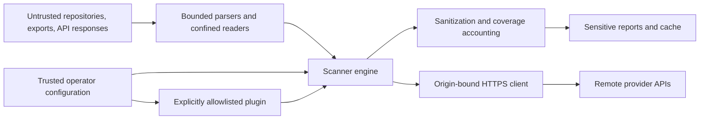

# Threat model

A consolidated view of what ShadowScan trusts, what it does not, and which
control enforces each boundary. It restates the trust model that
[`AGENTS.md`](https://github.com/aisecnomad/Nexus-ShadowScan/blob/main/AGENTS.md)
holds for contributors and the per-connector egress and limit notes in
[production](../production.md), so a reviewer can start here instead of
reassembling them. [SECURITY.md](../security.md) remains the reporting policy.

## What is being protected

ShadowScan reads security-sensitive estates and writes reports about them. The
assets are, in order of severity if lost:

1. **Operator and tenant credentials** supplied to connectors, and any
   credential present in the material being scanned.
2. **Scan output** — findings, record exports, caches and dashboards. These
   describe where unmanaged AI agents run, so they are sensitive inventory even
   after redaction.
3. **The workstation or CI runner** executing the scan.
4. **Scan integrity** — an operator must never read an incomplete scan as a
   clean one.

## Trust boundaries

**Trusted:** the operator workstation or CI runner, the scan configuration, and
installed Python packages.

**Untrusted:** remote API responses, scanned repositories, offline exports,
third-party plugins, and the benchmark corpora and artifacts under
`benchmarks/` — which hold prompt-injection text and MCP launch commands on
purpose and are never executed.

The configuration is trusted because an operator authors it. It can therefore
grant capability deliberately, and each such grant is explicit and narrow
rather than implied.

The process boundary around a plugin controls its lifecycle, not its access to
operator resources. A report remains sensitive after sanitization. Cloud SDKs
have separate transports; use network-level egress controls where required.

## Threats and controls

Grouped by boundary, in STRIDE terms where the category is meaningful.

### Scanned content reaching the scanner (untrusted input)

| Threat | Control | Where |
|---|---|---|
| Code execution via deserialization (the PyTorch pickle vector) | Model artifacts are header-parsed only; `.pt`/`.bin`/`.pkl` are *reported* as `unsafe-serialization` and never loaded. Nothing in the scanner unpickles. | `connectors/endpoint/runtime.py` |
| Code execution via YAML object construction | `SafeLoader` subclass; explicit object tags are rejected. | `utils/safe_yaml.py` |
| Denial of service by YAML expansion (billion laughs) | Node, alias, depth, expanded-node and expanded-character budgets, applied across every document in a stream. | `BoundedSafeLoader` |
| Denial of service by quadratic scalar parsing | YAML 1.1 sexagesimal integers are built by repeated big-integer multiplication; number scalars are length-bounded. | `BoundedSafeLoader.MAX_NUMBER_CHARS` |
| Denial of service by catastrophic regex backtracking | Signature matching runs under a per-pattern timeout (the reason `regex` is a dependency; stdlib `re` has none), charged against CPU time so that scheduler contention is not mistaken for backtracking. Exhaustion raises `MatchTimeoutError` and the input is incomplete. | `signatures/matcher.py` |
| Reading outside the scan root via symlinks | Directory walks open with `O_NOFOLLOW` \| `O_DIRECTORY` (and `O_PATH` where present); a link is recorded as skipped coverage, never followed. | `utils/files.py` |
| Credential disclosure through parser errors | Third-party and parser exception text is sanitized and bounded, or omitted. YAML error marks contribute positions only, never the source line, which may hold a credential. | `errors.py` |
| Prompt injection in scanned text steering the scanner | The scanner does not act on scanned content. Optional LLM triage treats it as data under a bounded budget. | `triage.py` |

### The scanner reaching the network (egress)

| Threat | Control | Where |
|---|---|---|
| SSRF to cloud metadata and internal services | HTTPS is required; loopback, link-local, private, multicast, unspecified, reserved and cloud-metadata destinations are refused, including obfuscated spellings. | `validate_url`, `utils/http.py` |
| DNS rebinding between validation and connect | Addresses are validated inside `_new_conn` and the socket connects to the numeric result, while TLS keeps the original hostname for SNI and certificate verification. *Every* answer is checked, so a mixed public/private result is refused rather than only the first record. | `_PublicHTTPSConnection` |
| DNS rebinding between the clone URL check and Git's connect | Git resolves names itself, so the clone host is resolved once more, every answer is checked, and Git is pinned to those answers with `http.curloptResolve`, proxy variables ignored. A host with no answer in time, or whose spelling libcurl would read differently from the pin (non-ASCII, percent-encoded), is not cloned. | `clone_pins`, `resolve_destination` |
| URL parser differentials | A URL containing whitespace or a control character is refused rather than normalised, because `urlsplit`, git and libcurl disagree about them. | `validate_url` |
| A server-supplied link leaving the credential's origin | Pagination and continuation links are pinned to the configured origin, including its port. | `validate_url(origin=...)` |
| Credential theft via git configuration of untrusted content | `url.*.insteadOf`, credential helpers and smudge filters cannot act: system and global configuration are disabled, inherited `GIT_CONFIG_*` is stripped, and the terminal prompt is off. Git is not passed the provider token variables (`GITHUB_TOKEN`, `GH_TOKEN`, `GITLAB_TOKEN`); a clone carries only its origin-scoped header. | `safe_git_env`, `utils/git.py` |
| Weakened transport | TLS verification is never disabled; a private CA is added through `ca_bundle` rather than by turning verification off. | `utils/http.py` |
| Unbounded responses | Response bodies are size-capped and must also finish within a multiple of the client timeout, so a slow drip cannot hold a connector open. | `MAX_RESPONSE_BYTES`, `READ_DEADLINE_FACTOR` |

Private destinations require a deliberate grant. Prefer the per-connector
`allow_private_origin`, which applies to that connector alone, over the
scan-wide `options.allow_private_origin`, which applies to every connector in
the configuration. The operator's `--deny-private-origin` overrides both
grants for this scanner's HTTPS clients, and a connector that sets the key
reads `false` there. It does not revoke `options.allow_instance_credentials`:
under that opt-in cloud connectors still contact the instance metadata
service, and the `cloud.gcp` credential transport accepts a private token
endpoint, so pass `--deny-instance-credentials` as well to keep cloud
connectors off both. See [configuration](../getting-started/configuration.md).

### Scan output (disclosure)

| Threat | Control | Where |
|---|---|---|
| Credentials persisted in findings or exports | Known token formats, credential-bearing URLs and credential-named fields are withheld before anything is persisted. Redaction does not depend on signature settings: disabling secret discovery must never disable redaction. | `utils/redaction*.py` |
| Opaque secrets with no recognizable format | A name that always carries a credential withholds its value; a name that carries one only when the value is opaque (`key`) withholds it when the value looks generated, in single-line, block-scalar and quoted forms alike. Evidence snippets additionally withhold random-looking quoted literals. | `redaction_assignments.py`, `redaction_entropy.py` |
| Correlating a credential across reports or tenants | Credential pseudonyms are a domain-separated HMAC under a per-scan random key, so they are not comparable between scans unless the operator supplies a stable `SHADOWSCAN_IDENTITY_KEY`. | `utils/credential_identity.py` |
| Raw tokens in output | JWTs are never stored; a finding references a truncated digest. Secret stores are read for names only. | `connectors/identity/jwt.py` |
| Keys leaking through diagnostics | The identity key never reaches a log, report, cache, export or diagnostic, and a set but unusable key stops the scan rather than silently falling back. | `engine.py` |

### Scan integrity

Fail-closed is the central contract: limits, malformed exports, denied APIs and
timed-out connectors mark the scan **incomplete** and exit `3`. An incomplete
scan is never presented as an empty one — findings already gathered are still
reported, alongside the sanitized reason and the affected connector. Exit `3`
also covers an incomplete comparison, merge or dashboard input.

### Plugins

An allowlisted plugin runs with scanner privileges. `plugin_process.py`
provides **lifecycle** isolation — a dedicated, killable process per connector
so an individual timeout can be enforced — and results cross the boundary as
one length-prefixed, size-bounded JSON message, never pickle. It is **not a
security sandbox**. Review any enabled third-party plugin as you would any code
you run, and scope the audit identity to the documented read permissions.

### Supply chain

Dependencies are hash-locked and `--require-hashes`; GitHub Actions are pinned
by full commit SHA with `persist-credentials: false` on checkouts that do not
push; the container is digest-pinned, installs under hash-locked requirements,
strips SUID/SGID bits and runs as a non-root user. Releases carry build
provenance and a CycloneDX SBOM attestation. See
[publishing](../operations/publishing.md).

## Residual risks

Stated plainly, because the controls above do not cover them:

- **Redaction is best-effort.** It recognises credential *formats* and
  credential *names*, plus opaque values given to credential-like names. An
  arbitrary secret with neither a recognizable format nor a credential-bearing
  name can survive. Reports also contain sensitive inventory by design, so
  treat output as sensitive regardless of redaction. Use synthetic, minimal
  examples in public reports.
- **A plugin is not sandboxed**, as above.
- **External transports carry their own egress controls.** The HTTPS client's
  private-address policy does not extend to the cloud SDKs, and reaches Git
  only through the addresses a clone is pinned to; restrict egress at the
  network when that matters.
- **An allowed private origin is a real grant.** It disables the
  private-address refusal for whatever it covers.
- **Offline replay is not live acceptance.** Canaries validate named tenant
  controls only when credentials are supplied.
- **No independent review.** ShadowScan has a single maintainer and
  AI-assisted development. Green CI, Scorecard, CodeQL and the logs under
  `archive/reviews/` are not a second-person audit. Review the revision
  yourself and pin a reviewed 40-character commit SHA. Reviewers can start
  from the [reviewer packet](../operations/reviewer-packet.md).
- **Detection quality is measured on author-written corpora.** The evaluation
  and benchmark numbers show behavior on those inputs, not field precision.
  See [evaluation](../evaluation.md).

## Reporting

Vulnerabilities go through a private GitHub security advisory only; see
[SECURITY.md](../security.md). Never paste credentials, tenant exports or
exploit details into an issue, pull request, commit message or workflow log.
